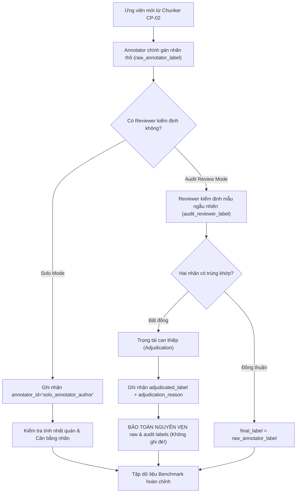

# Hướng Dẫn Gán Nhãn Bằng Chứng Tương Đồng & Nguồn Gốc Dữ Liệu (CP-03.1)

> **Mã mốc:** `CP-03.1`  
> **Thời điểm ban hành:** 2026-10-30  
> **Áp dụng cho:** Đội ngũ gán nhãn, annotator đơn lẻ (solo annotator), reviewer kiểm định độc lập, và bộ công cụ xử lý dữ liệu huấn luyện/kiểm thử benchmark.  
> **Nguyên tắc xuyên suốt:** **Tính trung thực học thuật & Bảo toàn nguồn gốc nhãn (Label Provenance)**.

---

## 1. Nguyên Tắc Cốt Lõi & Tính Trung Thực Học Thuật

Trong các nghiên cứu xử lý ngôn ngữ tự nhiên (NLP) phục vụ rà soát tính liêm chính học thuật, sai lầm phổ biến nhất là **đơn giản hóa nhị phân (Binary over-simplification)**: coi mọi đoạn văn bản có độ tương đồng từ vựng cao là "đạo văn", hoặc tự động giả định hệ thống có 2–3 chuyên gia gán nhãn độc lập trong khi thực tế chỉ có một lập trình viên tự gán nhãn.

Để xây dựng bộ benchmark có giá trị khoa học thực sự cho luận văn đại học/thạc sĩ (tiếng Việt & tiếng Anh), hướng dẫn này quy định nghiêm ngặt:

1. **Minh bạch về nhân lực gán nhãn:**
   - Nếu dự án chỉ có **một người gán nhãn chính (Solo Annotator)**, hệ thống **bắt buộc phải ghi nhận rõ ràng** `annotator_id="solo_annotator_author"`.
   - Tuyệt đối **không được tự tạo nhãn giả lập** `reviewer_2_label` để "vượt qua" các bài kiểm tra tự động.
   - Người đánh giá độc lập bên ngoài (nếu có) được định nghĩa là **Audit Reviewer** (kiểm định chất lượng trên tập mẫu ngẫu nhiên $10\% - 20\%$), không phải người gán nhãn song song toàn bộ.
2. **Bảo tồn tuyệt đối nhãn thô (Raw Label Immutability):**
   - Khi có bất đồng giữa annotator và reviewer, quyết định trọng tài (`adjudicated_label`) được lưu ở trường riêng kèm `adjudication_reason`.
   - **Tuyệt đối không ghi đè** lên `raw_annotator_label` hoặc `audit_reviewer_label`.
3. **Phân định rõ ràng giữa "Tái sử dụng nội dung" và "Đạo văn":**
   - Người gán nhãn chỉ xác định **sự thật khách quan về việc nội dung có bị tái sử dụng hay không** (`reuse_label`), kèm theo loại hình (`reuse_type`) và trạng thái trích dẫn (`citation_status`).
   - Việc kết luận "có đạo văn hay không" thuộc thẩm quyền của Hội đồng chuyên môn và Giảng viên hướng dẫn sau khi xem xét ngữ cảnh đào tạo và quy chế học vụ.

---

## 2. Hệ Thống Nhãn Phân Loại Chuẩn Hóa

Mỗi cặp đoạn văn $(\text{query\_text}, \text{source\_text})$ được gán nhãn đa chiều theo 3 trục độc lập:

### 2.1. Trục 1: Nhãn Tái Sử Dụng (`reuse_label`)

| Giá trị | Tên nhãn | Định nghĩa chi tiết | Tiêu chí nhận diện |
| :---: | :--- | :--- | :--- |
| **`1`** | **Reuse** (Có tái sử dụng) | Đoạn văn truy vấn mượn ý tưởng, cấu trúc câu, từ ngữ hoặc lập luận từ đoạn văn nguồn. | Xuất hiện sự tương đồng ngữ nghĩa đặc thù vượt quá mức ngẫu nhiên; có dấu hiệu sao chép, diễn giải lại hoặc dịch thuật. |
| **`0`** | **Non-reuse** (Độc lập) | Hai đoạn văn được soạn thảo hoàn toàn độc lập, không có sự vay mượn văn bản. | Trùng lặp chỉ do các thuật ngữ chuyên ngành chuẩn mực, định nghĩa phổ thông trong sách giáo khoa, hoặc mẫu câu chào hỏi/giới thiệu thông thường. |
| **`uncertain`** | **Uncertain** (Chưa chắc chắn) | Không đủ thông tin trong phạm vi 1 chunk để kết luận dứt khoát. | Cần phải mở rộng xem toàn bộ đoạn văn/trang xung quanh hoặc tra cứu tài liệu gốc bên ngoài mới có thể xác định. |

---

### 2.2. Trục 2: Loại Hình Tái Sử Dụng (`reuse_type`)

Áp dụng khi `reuse_label == 1` (nếu `reuse_label == 0`, gán `reuse_type="independent"`):

1. **`verbatim` (Sao chép nguyên văn):**
   - Sao chép nguyên vẹn hoặc gần như nguyên vẹn ($\ge 85\%$ số từ trùng lặp theo đúng thứ tự).
   - Chỉ có thay đổi nhỏ không đáng kể (như dấu câu, đổi 1–2 từ nối, lỗi chính tả).
2. **`paraphrase` (Diễn đạt lại / Viết lại):**
   - Cùng một ý tưởng, thuật toán, lập luận hoặc phát hiện khoa học nhưng được diễn đạt lại bằng từ ngữ khác, thay đổi thể chủ động/bị động, đảo trật tự mệnh đề, dùng từ đồng nghĩa.
3. **`translated` (Dịch thuật):**
   - Dịch từ một ngôn ngữ khác (chủ yếu từ tiếng Anh sang tiếng Việt) giữ nguyên cấu trúc đoạn văn, số liệu hoặc luận điểm mà không ghi nhận nguồn dịch.
4. **`summary` (Tóm tắt rút gọn):**
   - Rút gọn một đoạn văn dài, một phần lý thuyết phức tạp thành 1–2 câu ngắn gọn nhưng giữ nguyên các ý chính đặc thù của nguồn.
5. **`independent` (Độc lập):**
   - Không có tái sử dụng.

---

### 2.3. Trục 3: Trạng Thái Trích Dẫn (`citation_status`)

1. **`cited` (Có trích dẫn hợp lệ):**
   - Có chỉ mục trích dẫn rõ ràng ngay trong hoặc cuối đoạn văn (ví dụ `[12]`, `(Vaswani et al., 2017)`, `theo nghiên cứu của Nguyễn Văn A...`).
   - Nếu là trích dẫn nguyên văn, có đặt trong dấu ngoặc kép `"..."`.
2. **`uncited` (Không trích dẫn):**
   - Hoàn toàn không có bất kỳ dấu hiệu chỉ mục, tên tác giả, hoặc dấu ngoặc kép nào ghi nhận nguồn.
3. **`incorrect_citation` (Trích dẫn sai / Ngụy tạo):**
   - Có trích dẫn nhưng trỏ đến nguồn không liên quan, trích dẫn lập lờ ở một câu không liên quan để tạo cảm giác bài viết có dẫn nguồn đầy đủ.
4. **`not_applicable` (Không áp dụng):**
   - Dành cho các cặp `reuse_label == 0` (Non-reuse).

---

## 3. Các Bẫy Phổ Biến Cần Tránh Khi Gán Nhãn

### Bẫy 1: Trùng Thuật Ngữ Kỹ Thuật (Lexical Technical Jargon) $\longrightarrow$ Gán `0` (Non-reuse)
- **Hiện tượng:** Cả hai khóa luận ngành CNTT đều viết: *"Hệ thống sử dụng cơ sở dữ liệu quan hệ PostgreSQL kết hợp với bộ nhớ đệm Redis để tối ưu hóa hiệu năng truy vấn và giảm tải cho máy chủ backend."*
- **Quy tắc:** Đây là cách diễn đạt kỹ thuật tiêu chuẩn trong ngành phần mềm, **KHÔNG PHẢI** tái sử dụng học thuật $\rightarrow$ **Gán `0` (`independent`)**.

### Bẫy 2: Công Thức Toán & Định Nghĩa Chuẩn Sách Giáo Khoa $\longrightarrow$ Gán `0` (Non-reuse)
- **Hiện tượng:** Định nghĩa hàm Cross-Entropy Loss, công thức tính Precision/Recall/F1-score, hoặc các tính chất của thuật toán Dijkstra.
- **Quy tắc:** Kiến thức nền tảng trong giáo trình chuẩn mực không tính là tái sử dụng ý tưởng $\rightarrow$ **Gán `0` (`independent`)**.

### Bẫy 3: Tiêu Đề Mục Lục, Trang Bìa, Lời Cảm Ơn $\longrightarrow$ Loại khỏi tập Candidate
- Đã được tự động loại bỏ ở tầng parser `CP-02.1` và `CP-02.2`. Nếu vẫn còn lọt vào candidate, annotator gắn cờ `status="excluded_noise"` thay vì gán nhãn `0` hay `1`.

---

## 4. Ví Dụ Minh Họa Chuẩn (Golden Calibration Examples)

### Ví Dụ 1: Tái Sử Dụng Diễn Đạt Lại (Paraphrase) — Không Trích Dẫn

> **Query Text:**  
> *"Kiến trúc Transformer loại bỏ hoàn toàn các mạng hồi quy tuần tự RNN và LSTM, thay vào đó dựa hoàn toàn trên cơ chế tự chú ý (Self-Attention) để tính toán mối quan hệ phụ thuộc giữa các từ trong câu một cách song song trên toàn chuỗi."*
>
> **Source Text:**  
> *"Nhằm giải quyết nút thắt tính toán tuần tự của mô hình RNN/LSTM, mô hình Transformer áp dụng cơ chế Self-Attention cho phép xử lý đồng thời mọi vị trí trong câu đầu vào, từ đó nắm bắt tương quan xa với tốc độ huấn luyện vượt trội."*

- **`reuse_label`:** `1`
- **`reuse_type`:** `paraphrase`
- **`citation_status`:** `uncited`
- **Giải thích:** Cùng cấu trúc lập luận đối chiếu (loại bỏ tuần tự RNN/LSTM $\rightarrow$ áp dụng Self-Attention $\rightarrow$ tính toán song song). Thay đổi từ vựng nhưng giữ nguyên cấu trúc luận điểm khoa học.

---

### Ví Dụ 2: Trùng Thuật Ngữ Chuyên Ngành — Độc Lập Hoàn Toàn (Non-reuse)

> **Query Text:**  
> *"Ứng dụng được xây dựng theo mô hình kiến trúc MVC (Model-View-Controller), sử dụng framework Spring Boot cho tầng backend và ReactJS cho tầng giao diện người dùng."*
>
> **Source Text:**  
> *"Để đảm bảo tính module hóa và dễ bảo trì, chúng tôi áp dụng mẫu thiết kế MVC với backend viết bằng NodeJS Express và frontend xây dựng bằng thư viện ReactJS."*

- **`reuse_label`:** `0`
- **`reuse_type`:** `independent`
- **`citation_status`:** `not_applicable`
- **Giải thích:** Cùng nhắc đến kiến trúc MVC và ReactJS, nhưng đây là các công nghệ phổ biến được lựa chọn độc lập trong hai bài toán phát triển phần mềm khác nhau. Không có sự sao chép luận điểm.

---

### Ví Dụ 3: Trích Dẫn Hợp Lệ (Legitimate Verbatim with Citation)

> **Query Text:**  
> *"Theo công bố của Vaswani và cộng sự [1]: 'The dominant sequence transduction models are based on complex recurrent or convolutional neural networks', nhóm nghiên cứu đề xuất một kiến trúc hoàn toàn mới dựa trên Self-Attention."*
>
> **Source Text:**  
> *"The dominant sequence transduction models are based on complex recurrent or convolutional neural networks that include an encoder and a decoder."*

- **`reuse_label`:** `1`
- **`reuse_type`:** `verbatim`
- **`citation_status`:** `cited`
- **Giải thích:** Sao chép nguyên văn câu tiếng Anh nhưng có ngoặc kép và chỉ mục trích dẫn `[1]` đầy đủ. Đây là hành vi học thuật chuẩn mực, không vi phạm liêm chính.

---

## 5. Quy Trình Phê Duyệt & Trọng Tài (Workflow & Adjudication Protocol)

1. **Giai đoạn gán nhãn thô:** Annotator điền `raw_annotator_label`, `reuse_type`, `citation_status`, `note`.
2. **Giai đoạn kiểm định mẫu:** Reviewer kiểm định điền `audit_reviewer_label` độc lập mà không nhìn thấy nhãn của annotator chính trước đó (blind review).
3. **Giai đoạn trọng tài:** Nếu có bất đồng giữa Annotator và Reviewer, chuyên gia thứ ba (hoặc giảng viên) phân xử, ghi rõ lý do vào `adjudication_reason`. Cả ba giá trị nhãn đều được lưu trữ vĩnh viễn trong cơ sở dữ liệu phục vụ nghiên cứu khả năng tái lập (reproducibility).

