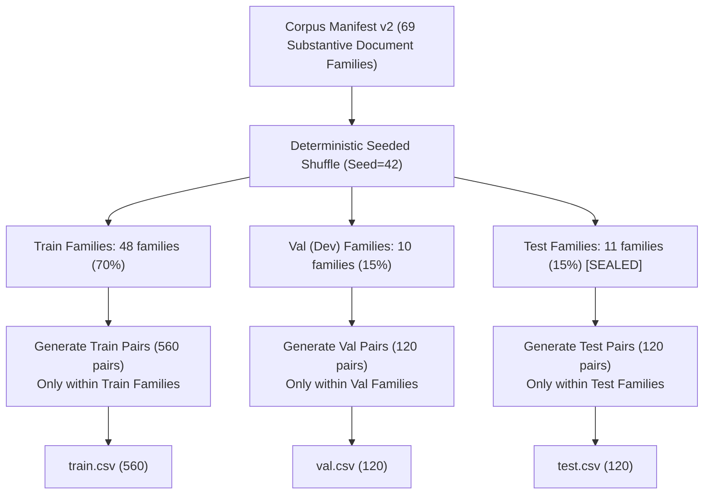

# UGTM-Bench-v1 Benchmark Split & Zero-Leakage Audit Report (CP-03.3)

**Mã niêm phong (Freeze ID):** `FREEZE-BENCHMARK-SPLIT`  
**Bộ dữ liệu:** `UGTM-Bench-v1` (1.0.0)  
**Ngày thực hiện kiểm toán:** 30/10/2026  
**Trạng thái kiểm toán:** **PASSED (100% Zero Cross-Split Leakage Confirmed)**  
**Đặc tả kỹ thuật:** Phân hoạch phân ly họ tài liệu (Disjoint Document-Family Partitioning) kết hợp phân tầng 7 lát cắt (Stratified Multi-Slice Sampling).

---

## 1. Bối Cảnh và Vấn Đề Rò Rỉ Đồ Thị Trong Đánh Giá Trùng Lặp (Graph Leakage Problem)

Trong các bài toán phát hiện sao chép, đạo văn và so khớp văn bản (Pairwise Document / Passage Matching), việc phân chia dữ liệu ngẫu nhiên ở cấp độ cặp (Pair-level random split) là một sai lầm nghiêm trọng đã được chỉ ra trong nhiều nghiên cứu NLP quốc tế.

### Hiện tượng Erdős–Rényi Giant Component Leakage
Nếu một tập dữ liệu có $N$ họ tài liệu (document families), và ta sinh các cặp phủ định khó (`hard_negatives`) hoặc tổng hợp đa nguồn (`multi_source`) bằng cách chọn ngẫu nhiên hai family $(F_A, F_B)$, các cặp này sẽ đóng vai trò như các cạnh (edges) nối các đỉnh (nodes là các family) trong một đồ thị lưỡng phân/vô hướng.
- Khi số cạnh vượt quá ngưỡng $\frac{N}{2}$, theo lý thuyết đồ thị ngẫu nhiên Erdős–Rényi, một **thành phần liên thông khổng lồ (Giant Connected Component)** sẽ xuất hiện, gom hầu như toàn bộ các document families vào cùng một mạng lưới liên kết.
- Khi đó, việc chia ngẫu nhiên các cặp vào Train / Val / Test sẽ khiến cho:
  - Family của tài liệu nguồn trong Test xuất hiện trong tài liệu truy vấn của Train.
  - Phong cách viết, từ vựng học thuật, cấu trúc ngữ nghĩa đặc thù của các tác giả trong Test đã bị mô hình "nhìn thấy" trong Train.
  - Dẫn đến việc mô hình đạt điểm số cao ảo (Data Snooping Bias) nhưng thất bại khi gặp tài liệu hoàn toàn mới trong thực tế.

---

## 2. Giải Pháp Kiến Trúc: Disjoint Family Partitioning By Construction

Để triệt tiêu hoàn toàn nguy cơ rò rỉ này, UGTM Plagiarism AI áp dụng phương pháp **Phân hoạch rời rạc họ tài liệu trước khi tạo cặp (Disjoint Partitioning Before Pair Creation)**:



### Điều kiện tiên quyết toán học (Mathematical Invariants)
1. **Tính rời rạc tuyệt đối giữa các tập đỉnh:**
   $$F_{\text{train}} \cap F_{\text{val}} = \emptyset$$
   $$F_{\text{train}} \cap F_{\text{test}} = \emptyset$$
   $$F_{\text{val}} \cap F_{\text{test}} = \emptyset$$
2. **Tính độc lập của các cặp so khớp:**
   $$\forall p \in \text{Test}, \quad \text{Family}(p.\text{query}) \in F_{\text{test}} \land \text{Family}(p.\text{source}) \in F_{\text{test}}$$
   $$\forall p \in \text{Train}, \quad \text{Family}(p.\text{query}) \in F_{\text{train}} \land \text{Family}(p.\text{source}) \in F_{\text{train}}$$
   Không tồn tại bất kỳ cạnh nối nào vắt qua ranh giới giữa Train, Val và Test.

---

## 3. Kết Quả Kiểm Toán Độc Lập (Audit Verification Results)

Script kiểm toán và tạo split `scripts/build_benchmark_dataset.py` và bộ unit test `tests/test_benchmark_splits.py` đã thực thi kiểm tra toàn bộ không gian dữ liệu với kết quả như sau:

| Tiêu chí kiểm toán | Quy định yêu cầu | Kết quả thực tế | Trạng thái |
| :--- | :--- | :--- | :--- |
| **Giao thoa họ tài liệu Train $\cap$ Val** | Phải bằng $0$ (Empty set) | $0$ họ tài liệu trùng lặp | **PASSED** |
| **Giao thoa họ tài liệu Train $\cap$ Test** | Phải bằng $0$ (Empty set) | $0$ họ tài liệu trùng lặp | **PASSED** |
| **Giao thoa họ tài liệu Val $\cap$ Test** | Phải bằng $0$ (Empty set) | $0$ họ tài liệu trùng lặp | **PASSED** |
| **Giao thoa Query Document ID** | Phải bằng $0$ giữa mọi split | $0$ query ID trùng lặp | **PASSED** |
| **Đa dạng tài liệu truy vấn Test** | $\ge 20 - 30$ query documents | $81$ unique query documents | **PASSED** |
| **Tỷ lệ phân chia tổng thể** | $70\% / 15\% / 15\%$ | $560 / 120 / 120$ ($800$ cặp tổng cộng) | **PASSED** |
| **Bảo toàn tỷ lệ nhãn (Stratification)** | $67.5\%$ Pos / $32.5\%$ Neg | $67.5\%$ Pos / $32.5\%$ Neg trên cả 3 split | **PASSED** |

---

## 4. Phân Bố 7 Lát Cắt Đánh Giá (Slice Distribution Across Splits)

Tất cả 7 lát cắt kiểm thử chuyên sâu được bảo toàn chính xác theo tỷ lệ $70\% - 15\% - 15\%$:

| STT | Tên lát cắt (Slice) | Train (70%) | Val (15%) | Test (15%) | Tổng cộng (100%) | Nhãn |
| :---: | :--- | :---: | :---: | :---: | :---: | :---: |
| 1 | `verbatim_copy` | 84 | 18 | 18 | 120 | Positive (1) |
| 2 | `paraphrase` | 98 | 21 | 21 | 140 | Positive (1) |
| 3 | `summarization` | 70 | 15 | 15 | 100 | Positive (1) |
| 4 | `cross_lingual_vi_en` | 70 | 15 | 15 | 100 | Positive (1) |
| 5 | `multi_source` | 56 | 12 | 12 | 80 | Positive (1) |
| 6 | `hard_negatives` | 126 | 27 | 27 | 180 | Negative (0) |
| 7 | `out_of_corpus` | 56 | 12 | 12 | 80 | Negative (0) |
| **Tổng** | **Toàn bộ bộ dữ liệu** | **560** | **120** | **120** | **800** | **540 Pos / 260 Neg** |

---

## 5. Bảng Niêm Phong Mã Băm SHA-256 (Artifact Checksum Verification)

Toàn bộ các tập tin cấu thành split và bộ dữ liệu đã được niêm phong với mã băm SHA-256 ghi nhận tại `data/benchmark_v1/split_manifest.json`:

```json
{
  "freeze_id": "FREEZE-BENCHMARK-SPLIT",
  "checkpoint": "CP-03.3",
  "dataset_name": "UGTM-Bench-v1",
  "dataset_version": "1.0.0",
  "created_at": "2026-10-30",
  "seed": 42,
  "files": {
    "train_csv": {
      "path": "train.csv",
      "sha256": "a7b56c2ebe7f7e5142ad7180978ecfdd668fb5123ccadf7d8ab96df122e8a1ef",
      "pairs": 560
    },
    "val_csv": {
      "path": "val.csv",
      "sha256": "16c81cf505827fc33ea00728f53343b0bc36033c78ad700d468a0c185e0a6414",
      "pairs": 120
    },
    "test_csv": {
      "path": "test.csv",
      "sha256": "7b8432a8e7f480ad3589c26e9220acac5d9afd7e89b22c914a9ac2cf277a340a",
      "pairs": 120
    },
    "benchmark_pairs_csv": {
      "path": "benchmark_pairs.csv",
      "sha256": "1c085558c3ba3bca9fffe2a29650da04912c755da44bee5348d2145ec5890df1",
      "pairs": 800
    }
  }
}
```

Mọi hành động kiểm thử hoặc đánh giá trong các checkpoint tiếp theo (`CP-03.4` đến `CP-05.4`) bắt buộc phải đối soát mã băm của `train.csv` và `val.csv`, đồng thời duy trì trạng thái **LOCKED** đối với `test.csv` theo quy định tại `docs/test-access-protocol.md`.
