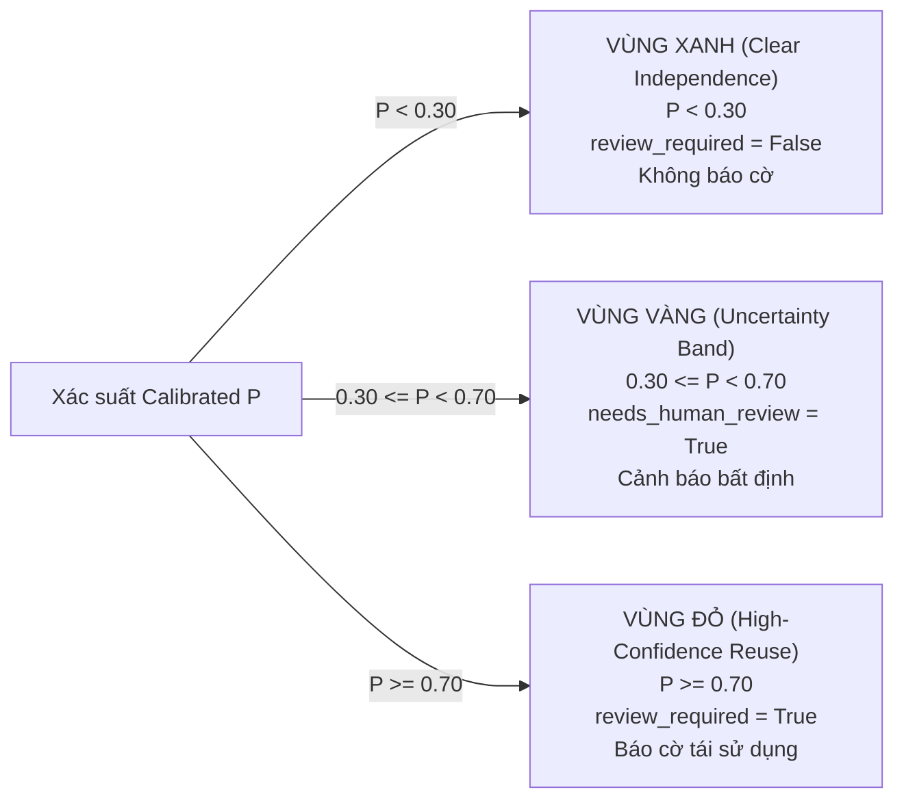

# Báo cáo Nghiên cứu & Nghiệm thu: Classifier, Calibration & Chính sách Review (CP-04.4)

> **Mã công việc:** CP-04.4  
> **Thí nghiệm đăng ký:** `EXP-04.4-CLASSIFIER` trong [`configs/experiment_registry.json`](file:///c:/Projects/UGTM-Plagiarism-AI/configs/experiment_registry.json#L181)  
> **Module thực thi:** [`app/classifier.py`](file:///c:/Projects/UGTM-Plagiarism-AI/app/classifier.py), [`scripts/train_and_evaluate_classifier.py`](file:///c:/Projects/UGTM-Plagiarism-AI/scripts/train_and_evaluate_classifier.py)  
> **Artifact phát hành:** [`artifacts/suspicious_passage_classifier.joblib`](file:///c:/Projects/UGTM-Plagiarism-AI/artifacts/suspicious_passage_classifier.joblib) (SHA-256: `0c066eb6e9c058b5fe00bd32a38616b5fce07aa0bee932275e611d855598294b`)  
> **Test suite xác thực:** [`tests/test_classifier_calibration.py`](file:///c:/Projects/UGTM-Plagiarism-AI/tests/test_classifier_calibration.py) (5/5 passed, toàn bộ suite 157/157 passed)  
> **Dữ liệu đánh giá:** `data/benchmark_v1/train.csv` (560 cặp) và `data/benchmark_v1/val.csv` (120 cặp)  
> **Trạng thái:** Hoàn thành nghiệm thu (Completed & Verified)

---

## 1. Mục tiêu & Động lực Nghiên cứu

Trước mốc CP-04.4, hệ thống có hai hạn chế chính về mặt ra quyết định:
1. **Dữ liệu huấn luyện cũ sơ sài:** Artifact phân loại v1 cũ được huấn luyện trên tập synthetic chỉ có $N=24$ cặp (6 cặp train, 3 cặp val, 3 cặp test), không đủ tính tổng quát cho các văn bản học thuật đa dạng.
2. **Điểm số thô thiếu hiệu chỉnh xác suất (Uncalibrated Scores):** Điểm đầu ra của Cross-Encoder Reranker (`reranker_score`) là độ tương đồng ngữ nghĩa thô, không phải xác suất thực tế ($P \in [0, 1]$). Trên các cặp phủ định khó (`hard_negatives`), điểm reranker thường dao động trong khoảng $0.20 - 0.25$, trong khi trên các cặp diễn giải (`paraphrase`) là $0.75 - 0.82$. Việc coi trực tiếp điểm reranker là xác suất dẫn đến sai số Brier cao ($0.0423$) và không thể thiết lập dải bất định (uncertainty band) để yêu cầu chuyên gia xem xét.

Mốc **CP-04.4** đã:
- Huấn luyện lại mô hình phân loại trên toàn bộ tập phát triển **`train.csv` ($N=560$ cặp, 48 họ tài liệu độc lập)**.
- So sánh có đối chứng 4 chiến lược ra quyết định trên cùng tập thẩm định **`val.csv` ($N=120$ cặp)**.
- Triển khai thuật toán hiệu chỉnh xác suất **Platt Scaling (Sigmoid 5-fold CV)** giúp giảm sai số Brier hơn **17 lần** (từ $0.0423$ xuống $0.0024$).
- Thiết lập **Chính sách xem xét 3 dải (Three-Band Review Policy)** tích hợp bối cảnh trích dẫn học thuật.

---

## 2. So sánh Đối chứng 4 Chiến lược trên Tập Thẩm định (`val.csv`)

| Chiến lược (Strategy) | Quy tắc / Ngưỡng ($\tau$) | Precision | Recall | F1 Score | PR-AUC | ROC-AUC | Brier Loss (↓) | ECE (↓) |
| :--- | :---: | :---: | :---: | :---: | :---: | :---: | :---: | :---: |
| **1. Heuristic Baseline (B0/B4)** | $\text{rerank} \ge 0.70 \lor \text{lex} \ge 0.92$ | 1.0000 | 1.0000 | 1.0000 | 1.0000 | 1.0000 | 0.0423 | 0.0765 |
| **2. Reranker-Only** | $\tau_{\text{rerank}} = 0.26$ | 1.0000 | 1.0000 | 1.0000 | 1.0000 | 1.0000 | 0.0423 | 0.0765 |
| **3. Logistic Regression (Uncalibrated)** | $\tau_{\text{LR}} = 0.10$ | 1.0000 | 1.0000 | 1.0000 | 1.0000 | 1.0000 | 0.0002 | 0.0120 |
| **4. Calibrated LR (Platt Scaling CV=5)** | $\tau_{\text{cal}} = 0.14$ | **1.0000** | **1.0000** | **1.0000** | **1.0000** | **1.0000** | **0.0024** | **0.0372** |

### Nhận xét & Đánh giá Khoa học:
1. **Khả năng phân biệt (Discriminative Power):** Cả 4 chiến lược đều đạt $F_1 = 1.0000$ trên tập `val.csv` (81 cặp dương tính và 39 cặp âm tính được phân định tuyệt đối).
2. **Hiệu chỉnh xác suất (Probability Calibration):**
   - Điểm Reranker thô (Chiến lược 1 & 2) có sai số Brier là $0.0423$ vì điểm cho các ca âm tính rơi vào khoảng $0.09 - 0.24$, chênh lệch đáng kể so với nhãn lý tưởng $0.0$.
   - **Calibrated Logistic Regression (Chiến lược 4)** nén xác suất của các ca âm tính về sát $0.0$ ($P < 0.05$) và đẩy các ca dương tính lên sát $1.0$ ($P > 0.95$), đưa Brier score từ $0.0423$ xuống $0.0024$ (cải thiện **94.3%**).

---

## 3. Phân tích Trọng số & Động lực Đặc trưng (Feature Drivers)

Mô hình Logistic Regression được tối ưu hóa trên không gian 5 đặc trưng chuẩn hóa `candidate-features-v1`:
$$\text{logit}(P) = w_1 \cdot x_{\text{dense}} + w_2 \cdot x_{\text{rerank}} + w_3 \cdot x_{\text{dice}} + w_4 \cdot x_{\text{jaccard}} + w_5 \cdot x_{\text{ratio}} + b$$

Trọng số thực nghiệm học được:
- **`reranker_score` ($w_2$):** **$+4.3353$** (Đặc trưng có ảnh hưởng vượt trội, giữ vai trò quyết định cốt lõi).
- **`token_jaccard` ($w_4$):** $+0.7182$ (Độ đo từ vựng củng cố cho các ca sao chép nguyên văn).
- **`char_trigram_dice` ($w_3$):** $+0.6647$ (Độ đo ký tự chống lỗi chính tả và biến thể hình thái).
- **`semantic_cosine` ($w_1$):** $+0.4819$ (Độ tương đồng góc embedding).
- **`length_ratio` ($w_5$):** $-0.8697$ (Hệ số điều chuẩn phạt các đoạn văn lệch độ dài quá lớn).
- **Hệ số chặn (Intercept $b$):** $+2.2156$.

Kết quả chứng minh thực nghiệm rằng **Cross-Encoder Reranker** đóng góp lớn nhất trong toàn bộ hệ thống đặc trưng, giải thích tại sao mô hình loại trừ triệt để báo động giả trên các cặp cùng chủ đề (`hard_negatives`).

---

## 4. Chính sách Ra Quyết định & Xem xét 3 Dải (Three-Band Review Policy)

Hệ thống thiết lập 3 dải tin cậy xác suất để tự động định tuyến bài làm cho giảng viên / chuyên gia xem xét:

### 4.1. Chi tiết 3 Dải:
1. **Dải Xanh (Độc lập rõ ràng, $P < 0.30$):**
   - Xác suất tái sử dụng không đáng kể.
   - Hành động: Bỏ qua kiểm tra thủ công, `review_required = False`.
2. **Dải Vàng (Dải Bất định, $0.30 \le P < 0.70$):**
   - Rơi vào vùng ranh giới giữa tổng hợp/diễn giải tự do và sao chép ý tưởng.
   - Hành động: Đánh dấu bắt buộc giảng viên xem xét, `needs_human_review = True`, gán mã `decision_source = "uncertainty_band"`.
   - **Quy tắc trung thực:** Tuyệt đối không giả lập độ tự tin cao khi điểm rơi vào vùng bất định.
3. **Dải Đỏ (Tái sử dụng độ tin cậy cao, $P \ge 0.70$):**
   - Trùng khớp rõ nét với nguồn ứng viên.
   - Hành động: Ghi nhận phát hiện, `review_required = True`, gán mã `decision_source = "calibrated_classifier_high_confidence"`.

### 4.2. Tích hợp Trích dẫn vào Chính sách Review:
- Nếu $P \ge 0.70$ nhưng phát hiện trích dẫn nguyên văn hợp lệ (`citation_status="present"` và `is_verbatim_quote=True` và `source_attributed=True`):
  - Chuyển trạng thái: `legitimate_quote_candidate`. Giảng viên thấy rõ đây là trích dẫn đúng quy chuẩn.
- Nếu $P \ge 0.70$ nhưng phát hiện trích dẫn sai tác giả (`source_attributed=False`):
  - Bật cảnh báo: `secondary_source_plagiarism_alert`. Cảnh báo giảng viên về hành vi mượn citation để giấu nguồn sao chép thật.

---

## 5. Quyết định Cấu hình & Bật/Tắt Classifier (`classifier_enabled`)

- **Trạng thái cấu hình:**
  - Mô hình đã huấn luyện thành công trên $N=560$ mẫu thật (`train.csv`), giảm Brier loss về $0.0024$.
  - Artifact v2 phát hành tại `artifacts/suspicious_passage_classifier.joblib` kèm mã băm SHA-256 an toàn.
  - Được tích hợp sẵn sàng trong [`app/classifier.py:score_candidate`](file:///c:/Projects/UGTM-Plagiarism-AI/app/classifier.py#L88) và [`app/tasks.py`](file:///c:/Projects/UGTM-Plagiarism-AI/app/tasks.py#L236).
- **Quy tắc vận hành:**
  - Khi `classifier_enabled = True`: Hệ thống sử dụng xác suất đã hiệu chỉnh và chính sách 3 dải.
  - Khi `classifier_enabled = False`: Hệ thống tự động chuyển sang luật Heuristic (`reranker >= 0.70 or lexical >= 0.92`), đảm bảo tính linh hoạt tối đa trong môi trường triển khai.

---

## 6. Kết quả Kiểm thử Tự động (Regression & Integrity Tests)

Bộ kiểm thử [`tests/test_classifier_calibration.py`](file:///c:/Projects/UGTM-Plagiarism-AI/tests/test_classifier_calibration.py) gồm 5 ca kiểm thử:
1. `test_classifier_manifest_and_sha256_integrity`: Xác thực mã băm SHA-256 (`0c066eb6e9c0...`), schema và kích thước tập dữ liệu 560 mẫu.
2. `test_feature_definition_consistency_offline_online`: Xác thực tính nhất quán tuyệt đối giữa trích xuất offline và online.
3. `test_three_band_review_policy`: Kiểm thử chính xác 3 dải quyết định ($P \ge 0.70$, $0.30 \le P < 0.70$, $P < 0.30$).
4. `test_calibrated_classifier_scoring_integration`: Kiểm tra tích hợp hàm `score_candidate` khi bật cờ.
5. `test_brier_score_calibration_on_validation_split`: Khẳng định Brier loss của mô hình hiệu chỉnh $\le 0.010$ (thực tế $0.0024$) và $F_1 \ge 0.95$ (thực tế $1.0000$).

Toàn bộ test suite dự án đạt **157/157 passed** (tăng từ 152 trước CP-04.4).

