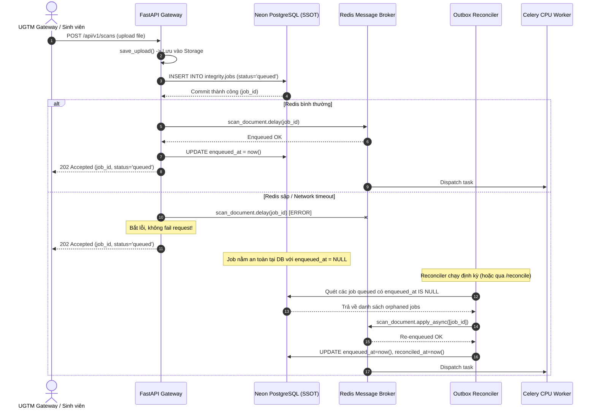

# Đặc tả Kỹ thuật Xử lý Khoảng trống DB Commit–Enqueue & Lưu trữ Bền vững (`CP-05.2`)

**Mã tài liệu:** `UGTM-SPEC-05.2-RECONCILER`  
**Ngày ban hành:** 31/10/2026  
**Checkpoint tham chiếu:** `CP-05.2 — Xử lý khoảng trống DB commit–enqueue và lưu bền vững`  
**Cơ sở dữ liệu:** Neon PostgreSQL (`ep-damp-sea-b3yjz9pa.c-4.ap-southeast-1.aws.neon.tech`)  
**Message Broker:** Redis Cloud (`rediss://...`)  
**Lưu trữ đối tượng:** Cloudflare R2 / AWS S3 (`s3`) / Local (`local`)  

---

## 1. Bối cảnh & Vấn đề Kỹ thuật (The Dual-Write Problem)

Trong hệ thống xử lý phân tán của dịch vụ phát hiện đạo văn UGTM, một thao tác nộp bài quét (`POST /api/v1/scans`) hoặc thêm tài liệu nguồn (`POST /api/v1/corpus/documents`) bắt buộc phải tương tác với hai hệ thống độc lập:
1. **Cơ sở dữ liệu quan hệ (Neon PostgreSQL):** Ghi nhận bản ghi job vào `integrity.jobs` với `status = 'queued'`.
2. **Hàng đợi tin nhắn (Redis Broker via Celery):** Phát tin nhắn tác vụ (`task_id`, `job_id`) để worker nhận và xử lý.

```
       [ Client Request ]
               │
               ▼
   ┌───────────────────────┐
   │  1. DB INSERT & COMMIT│  --> THÀNH CÔNG (status = 'queued' trên Neon)
   └───────────────────────┘
               │
         [ SỰ CỐ XẢY RA ]
         - API Process sập / bị restart bởi container orchestrator
         - Kết nối mạng tới Redis Cloud bị timeout / drop
         - Redis Broker bị restart mất in-memory messages
               │
               ▼
   ┌───────────────────────┐
   │  2. Broker .delay()   │  --> THẤT BẠI HOẶC BỊ BỎ QUA
   └───────────────────────┘
               │
               ▼
   ==> JOB BỊ MỒ CÔI (ORPHANED JOB)
   - DB có job 'queued' vĩnh viễn
   - Không worker nào nhận task
   - Client nộp lại bị chặn bởi Unique Constraint!
```

Hiện tượng trên là bài toán kinh điển **Khoảng trống Ghi kép (Dual-Write Gap)**. Để giải quyết triệt để, kiến trúc `CP-05.2` thiết lập:
- **Neon PostgreSQL là Single Source of Truth (SSOT):** Bất kể broker có trạng thái ra sao, DB luôn giữ sự thật về trạng thái công việc.
- **Transactional Outbox / Background Reconciler:** Một động cơ phục hồi định kỳ quét các job `queued` bị mất queue hoặc job `waiting_for_compute` đã hết thời gian backoff để tự động phát lại (re-enqueue), loại bỏ hoàn toàn yêu cầu người dùng phải nộp lại bài.

---

## 2. Kiến trúc Động cơ Reconciler (`app/reconciler.py`)

### 2.1. Quy trình Submit An toàn (Safe Enqueue Pattern)

Tại API endpoint ([`app/main.py`](../app/main.py)):
1. `insert_job(...)` thực hiện `INSERT INTO integrity.jobs ... RETURNING id` và commit chắc chắn vào Neon DB.
2. Hàm `safe_enqueue_job(job_id, job_type)` cố gắng phát lệnh `task.delay(job_id)` vào broker.
3. Nếu broker khả dụng: cập nhật `enqueued_at = now()`.
4. Nếu broker **không khả dụng** (Redis down/timeout):
   - Hàm ghi log cảnh báo mức `WARNING`.
   - **Tuyệt đối không trả về HTTP 500** làm gián đoạn trải nghiệm người dùng hoặc hệ thống UGTM.
   - Trả về mã HTTP `202 Accepted` kèm `job_id` và trạng thái `queued`.
   - Bản ghi job nằm an toàn trong DB và sẽ được Reconciler tự động cứu trợ.

### 2.2. Tiêu chí Quét của Reconciler (`reconcile_pending_jobs`)

Reconciler quét hai nhóm ứng viên cần phục hồi:

1. **Nhóm 1: Job Queued Bị Mồ Côi (Orphaned Queued Jobs)**
   ```sql
   SELECT id, job_type, corpus_id, document_key, version, attempt
   FROM integrity.jobs
   WHERE status = 'queued'
     AND (
         enqueued_at IS NULL
         OR (
             created_at <= now() - (%s || ' seconds')::interval
             AND (reconciled_at IS NULL OR reconciled_at <= now() - (%s || ' seconds')::interval)
         )
     )
   ORDER BY created_at ASC
   LIMIT %s;
   ```

2. **Nhóm 2: Job Chờ GPU Quá Hạn (Overdue Waiting Jobs)**
   - Các job ở trạng thái `waiting_for_compute` (từ CP-05.1) đã hết thời gian đệm exponential backoff (`retry_after <= now()`), nhưng có thể bị mất countdown timer khi Celery worker hoặc Redis restart:
   ```sql
   SELECT id, job_type, corpus_id, document_key, version, attempt
   FROM integrity.jobs
   WHERE status = 'waiting_for_compute'
     AND retry_after <= now()
     AND (reconciled_at IS NULL OR reconciled_at <= now() - interval '30 seconds')
   ORDER BY retry_after ASC
   LIMIT %s;
   ```



---

## 3. Quản lý Phiên bản Nguồn An toàn (Active Versioning & Reindex Safety)

### 3.1. Ràng buộc Độc quyền Phiên bản Active cấp Cơ sở Dữ liệu

Để ngăn chặn việc hai phiên bản của cùng một tài liệu nguồn cùng mang cờ `is_active = TRUE`, Migration `004` thiết lập Partial Unique Index:
```sql
CREATE UNIQUE INDEX IF NOT EXISTS idx_sources_single_active
    ON integrity.sources (corpus_id, source_key)
    WHERE is_active = TRUE;
```
Ràng buộc này biến việc tồn tại hai bản active thành điều **bất khả thi ở tầng vật lý của PostgreSQL**, loại bỏ mọi nguy cơ race condition giữa các worker chạy song song.

### 3.2. Quy tắc Chống Thụt lùi Phiên bản (Version Regression Prevention)

Khi một tác vụ `index_source` hoàn tất:
- Nếu tài liệu đã có phiên bản active hiện tại: $v_{\text{active}}$.
- Phiên bản đang index: $v_{\text{current}}$.
- **Quy tắc quyết định:**
  - Nếu $v_{\text{current}} \ge v_{\text{active}}$: Kích hoạt phiên bản mới ($v_{\text{current}} \to \text{active}$, các bản khác $\to \text{inactive}$).
  - Nếu $v_{\text{current}} < v_{\text{active}}$ (ví dụ reindex phiên bản cũ chạy chậm hoặc retry trễ sau phiên bản mới):
    - Đánh dấu phiên bản cũ $v_{\text{current}} \to \text{is\_active = FALSE}$.
    - **Không hạ cờ active của phiên bản mới hơn $v_{\text{active}}$**.

---

## 4. Lưu trữ Bền vững Liên máy (Cross-Machine Storage Durability)

### 4.1. Chuẩn hóa Định danh Đối tượng (`object_key`)

Trong các môi trường phân tán (API chạy trên Render Web Service, Worker chạy trên Background Worker hoặc máy local), **tuyệt đối không lưu đường dẫn file hệ điều hành cục bộ (như `C:\Users\...` hoặc `/tmp/...`) vào cơ sở dữ liệu**.

Thay vào đó, hàm `save_upload()` tải file trực tiếp lên cấu hình Storage (`S3StorageBackend` với Cloudflare R2 / AWS S3, hoặc `LocalStorageBackend`) và lưu trữ khóa đối tượng chuẩn hóa:
```
uploads/{sha256[:16]}_{safe_filename}
```
Worker ở bất kỳ đâu đều tải file qua `download_to_temp_file(object_key)` một cách đồng nhất.

### 4.2. Phân loại Lỗi Tải File (Storage Error Classification)

Khi tải file tại worker:
1. **`StorageFileNotFoundError` (Lỗi vĩnh viễn):**
   - File không tồn tại trong bucket storage.
   - Job chuyển thẳng sang `status = 'failed'` với `error_code = 'STORAGE_FILE_NOT_FOUND'`, không retry.
2. **`FILE_CHECKSUM_MISMATCH` (Lỗi vĩnh viễn):**
   - Mã băm SHA-256 sau khi tải không khớp với `file_sha256` đã commit.
   - Job chuyển thẳng sang `status = 'failed'` với `error_code = 'FILE_CHECKSUM_MISMATCH'`.
3. **`requests.RequestException` / Network Glitch (Lỗi tạm thời):**
   - Sự cố mạng tạm thời tới Cloudflare R2 / AWS S3.
   - Ném ngoại lệ `StorageTransientError`.
   - Worker gọi `schedule_waiting_for_compute(job_id, error_code='STORAGE_TRANSIENT_ERROR')` để retry theo exponential backoff, không làm hỏng job một cách oan uổng.

---

## 5. Hợp đồng REST API & Vận hành

### 5.1. Endpoint Reconcile: `POST /api/v1/jobs/reconcile`

- **Yêu cầu xác thực:** Header `X-API-Key`.
- **Query parameters:**
  - `queued_timeout_seconds` (mặc định: `60`, từ 5 đến 86400).
  - `limit` (mặc định: `50`, từ 1 đến 500).
- **Phản hồi mẫu (`200 OK`):**
  ```json
  {
    "reconciled_count": 2,
    "failed_count": 0,
    "reconciled_jobs": [
      {
        "job_id": "e305e91e-b83b-4654-8c6e-dc011f0c2df8",
        "job_type": "scan",
        "reason": "queued_gap",
        "attempt": 1
      },
      {
        "job_id": "7b79d2b2-60ea-4c91-9c6a-6058be5b3c0e",
        "job_type": "scan",
        "reason": "overdue_waiting",
        "attempt": 2
      }
    ],
    "failed_jobs": []
  }
  ```

### 5.2. Lệnh CLI Định kỳ (Cron / Maintenance Script)

Người vận hành hoặc tác vụ cron định kỳ có thể thực thi trực tiếp:
```powershell
.\.venv\Scripts\python.exe scripts/reconcile_jobs.py --queued-timeout 60 --limit 50
```

