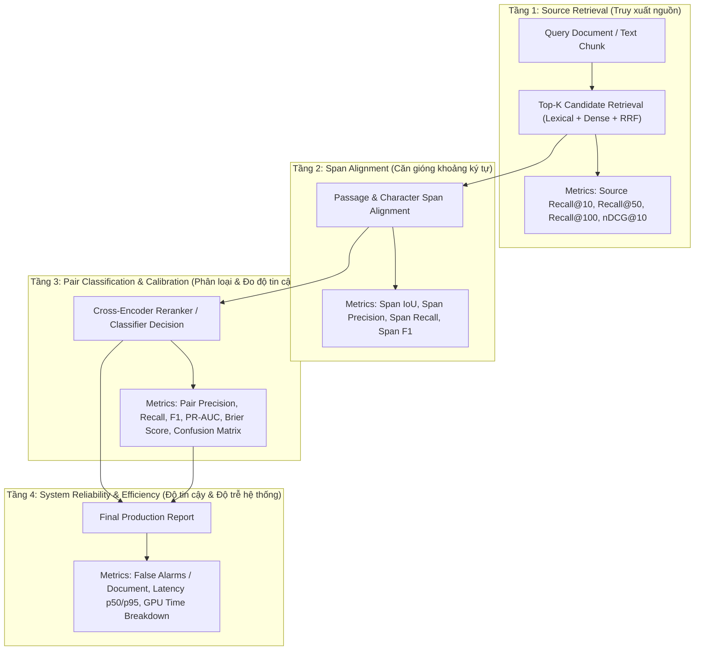

# Đặc Tả Kỹ Thuật Bộ Đánh Giá Đa Tầng & Lược Đồ Báo Cáo Metrics (CP-03.4)

**Mã tài liệu:** `docs/evaluator-specification-and-metrics-schema.md`  
**Phiên bản Evaluator:** `1.0.0`  
**Lược đồ báo cáo:** `Metrics Report Schema v1.0.0`  
**Tập tin thực thi chính:** [`app/evaluator.py`](../app/evaluator.py) & [`scripts/evaluate_benchmark.py`](../scripts/evaluate_benchmark.py)  
**Cấu hình chuẩn:** [`configs/evaluation_config.json`](../configs/evaluation_config.json)  
**Tập fixtures kiểm chứng tính tay:** [`tests/fixtures/evaluator_hand_fixtures.json`](../tests/fixtures/evaluator_hand_fixtures.json)  
**Ngày ban hành:** 30/10/2026  

---

## 1. Mục Tiêu Khoa Học & Kiến Trúc Đánh Giá Đa Tầng (Multi-Tier Evaluation)

Trong các hệ thống phát hiện đạo văn truyền thống, việc chỉ đo một chỉ số duy nhất như F1-score trên toàn bộ hệ thống (end-to-end black box) khiến việc xác định nguyên nhân gốc rễ (Root Cause) của các lỗi sai trở nên bất khả thi. Ví dụ:
- Nếu F1 thấp: Do bộ tìm kiếm (Retrieval) bỏ sót tài liệu gốc, hay do bộ căn gióng (Alignment) tính sai biên độ đoạn, hay do bộ phân loại (Classifier) đặt ngưỡng quyết định $\tau$ quá khắt khe?

Bộ đánh giá `UGTM-Evaluator-v1` giải quyết triệt để vấn đề này bằng cách chia tách quá trình kiểm thử thành **4 tầng độc lập**, cho phép bóc tách chính xác từng điểm nghẽn kỹ thuật:



---

## 2. Định Nghĩa Toán Học Từng Tầng Đánh Giá

### 2.1. Tầng 1: Source Retrieval Stage

Xét tài liệu truy vấn $q$ có tập các tài liệu nguồn thực sự chứa nội dung tái sử dụng là $S_q^* = \{s_1^*, s_2^*, \dots, s_m^*\}$.  
Danh sách ứng viên được hệ thống tìm kiếm trả về và xếp hạng là $R_q = [r_1, r_2, \dots, r_M]$.

- **Source Recall@K:** Tỷ lệ tài liệu nguồn chuẩn được tìm thấy trong Top $K$ ứng viên:
  $$\text{Recall@K}(q) = \frac{|\{r_1, r_2, \dots, r_K\} \cap S_q^*|}{|S_q^*|}$$
  *Quy tắc chuẩn hóa:* Các truy vấn không có nguồn liên quan trong kho ($|S_q^*| = 0$, ví dụ lát cắt `out_of_corpus` hoặc `hard_negatives`) được loại trừ khỏi mẫu số của Recall@K và được đánh giá riêng ở Tầng 4 (False Alarm Rate).

- **Discounted Cumulative Gain (DCG@K) & nDCG@K:** Đánh giá vị trí xếp hạng của tài liệu nguồn (tài liệu đúng xếp càng cao thì điểm càng cao):
  $$\text{DCG@K}(q) = \sum_{i=1}^K \frac{rel(r_i)}{\log_2(i + 1)}, \quad rel(r_i) = \begin{cases} 1 & \text{nếu } r_i \in S_q^* \\ 0 & \text{nếu } r_i \notin S_q^* \end{cases}$$
  $$\text{IDCG@K}(q) = \sum_{i=1}^{\min(K, |S_q^*|)} \frac{1}{\log_2(i + 1)}$$
  $$\text{nDCG@K}(q) = \frac{\text{DCG@K}(q)}{\text{IDCG@K}(q)}$$

- **Macro-Averaging:**
  $$\text{Macro-Recall@K} = \frac{1}{|Q_{\text{pos}}|} \sum_{q \in Q_{\text{pos}}} \text{Recall@K}(q)$$
  $$\text{Macro-nDCG@K} = \frac{1}{|Q_{\text{pos}}|} \sum_{q \in Q_{\text{pos}}} \text{nDCG@K}(q)$$

---

### 2.2. Tầng 2: Span Alignment Stage

Xét khoảng ký tự thực tế $G = [g_{\text{start}}, g_{\text{end}}]$ và khoảng ký tự do mô hình dự đoán $P = [p_{\text{start}}, p_{\text{end}}]$.  
Độ dài giao thoa ký tự (Character Intersection):
$$I(G, P) = \max(0, \min(g_{\text{end}}, p_{\text{end}}) - \max(g_{\text{start}}, p_{\text{start}}))$$
Độ dài hợp nhất (Character Union):
$$U(G, P) = (g_{\text{end}} - g_{\text{start}}) + (p_{\text{end}} - p_{\text{start}}) - I(G, P)$$

- **Intersection over Union (IoU):**
  $$\text{IoU}(G, P) = \frac{I(G, P)}{U(G, P)}$$
- **Span Precision, Recall, F1:**
  $$\text{Precision}_{\text{span}} = \frac{I(G, P)}{p_{\text{end}} - p_{\text{start}}}$$
  $$\text{Recall}_{\text{span}} = \frac{I(G, P)}{g_{\text{end}} - g_{\text{start}}}$$
  $$\text{F1}_{\text{span}} = \frac{2 \times \text{Precision}_{\text{span}} \times \text{Recall}_{\text{span}}}{\text{Precision}_{\text{span}} + \text{Recall}_{\text{span}}}$$
- **Span Match Rate:** Tỷ lệ các cặp có $\text{IoU} \ge \tau_{\text{IoU}}$ (mặc định $\tau_{\text{IoU}} = 0.30$).

---

### 2.3. Tầng 3: Pairwise Classification & Probability Calibration Stage

Cho tập nhãn thực tế $y_i \in \{0, 1\}$ và điểm xác suất dự đoán $\hat{y}_i \in [0, 1]$ từ Cross-Encoder hoặc Classifier, với ngưỡng quyết định $\tau$:

- **Ma trận nhầm lẫn (Confusion Matrix):**
  - $TP$: $y_i = 1 \land \hat{y}_i \ge \tau$
  - $FP$: $y_i = 0 \land \hat{y}_i \ge \tau$
  - $FN$: $y_i = 1 \land \hat{y}_i < \tau$
  - $TN$: $y_i = 0 \land \hat{y}_i < \tau$
- **Chỉ số phân loại:**
  $$\text{Precision} = \frac{TP}{TP + FP}, \quad \text{Recall} = \frac{TP}{TP + FN}, \quad \text{F1} = \frac{2 \cdot P \cdot R}{P + R}, \quad \text{Accuracy} = \frac{TP + TN}{TP + TN + FP + FN}$$
- **Brier Score (Đo lường mức độ chuẩn định xác suất - Calibration):**
  $$\text{Brier} = \frac{1}{N} \sum_{i=1}^N (\hat{y}_i - y_i)^2 \quad (\text{Càng gần } 0 \text{ càng chuẩn định tốt})$$
- **PR-AUC (Precision-Recall Area Under Curve):** Diện tích dưới đường cong Precision-Recall không phụ thuộc vào ngưỡng $\tau$.

---

### 2.4. Tầng 4: System Level & Production Reliability

- **False Alarm Rate per Document:** Số lượng cảnh báo sai trung bình mà một tài liệu sạch hoặc tài liệu không đạo văn phải gánh chịu:
  $$\text{FAR} = \frac{1}{|Q_{\text{neg}}|} \sum_{q \in Q_{\text{neg}}} \sum_{s \in \text{Retrieved}(q)} \mathbb{I}(\hat{y}_{(q, s)} \ge \tau)$$
  *Mục tiêu:* Càng thấp càng tốt (lý tưởng $< 0.5$ cảnh báo sai trên mỗi tài liệu luận văn).
- **Phân vị độ trễ (Latency Distribution):** Thống kê $p50$, $p95$, $p99$ và trung bình cho từng công đoạn:
  `parse_time_ms`, `dense_embed_time_ms`, `retrieval_time_ms`, `rerank_time_ms`, `alignment_time_ms`.

---

## 3. Cây Phân Loại Lỗi (Error Isolation & Failure Taxonomy)

Evaluator thực hiện kiểm tra chẩn đoán để xếp từng mẫu thất bại vào đúng tầng xảy ra lỗi:

| Mã lỗi định danh | Tầng thất bại | Điều kiện phát hiện | Ý nghĩa kỹ thuật |
| :--- | :--- | :--- | :--- |
| **`RETRIEVAL_MISS`** | Tầng 1 (Retrieval) | $y = 1 \land \text{Source}^* \notin \text{Candidates}_{\text{topK}}$ | Bộ tìm kiếm không đưa tài liệu đúng vào top K. Các tầng sau hoàn toàn không có cơ hội xử lý. |
| **`ALIGNMENT_BOUNDARY_ERROR`** | Tầng 2 (Alignment) | $y = 1 \land \text{Source}^* \in \text{Candidates} \land \text{IoU} < \tau_{\text{IoU}}$ | Tìm đúng tài liệu nhưng bộ căn gióng cắt sai vị trí, lệch câu hoặc bỏ sót thân bài. |
| **`CLASSIFIER_FALSE_NEGATIVE`** | Tầng 3 (Classifier) | $y = 1 \land \text{Source}^* \in \text{Candidates} \land \text{IoU} \ge \tau_{\text{IoU}} \land \hat{y} < \tau$ | Tìm đúng, căn gióng đúng, nhưng điểm số mô hình cho quá thấp nên bị bộ lọc loại bỏ. |
| **`CLASSIFIER_FALSE_POSITIVE`** | Tầng 3 (Classifier) | $y = 0 \land \hat{y} \ge \tau$ | Hai đoạn văn hoàn toàn độc lập nhưng mô hình báo động giả (False Alarm). |
| **`CORRECT`** | Thành công | $(y = 1 \land \text{All Pass}) \lor (y = 0 \land \hat{y} < \tau)$ | Hệ thống xử lý chính xác tuyệt đối theo ground-truth. |

---

## 4. Kiểm Chứng Bằng Bằng Chứng Tính Tay (Hand-Calculated Fixture Proof)

Bộ fixtures kiểm chứng được lưu tại [`tests/fixtures/evaluator_hand_fixtures.json`](../tests/fixtures/evaluator_hand_fixtures.json) và được kiểm toán tự động qua [`tests/test_evaluator.py`](../tests/test_evaluator.py).

### 4.1. Bảng Đối Soát Retrieval
- **Query 1:** Nguồn chuẩn `["doc_A"]`, Top-K trả về `["doc_X", "doc_A", "doc_Y", "doc_Z"]`:
  - Recall@1: $0.0$, Recall@2: $1.0$, Recall@3: $1.0$.
  - DCG@2: $\frac{0}{\log_2(2)} + \frac{1}{\log_2(3)} = 0.63092975$.
  - IDCG@2: $\frac{1}{\log_2(2)} = 1.0 \implies \text{nDCG@2} = 0.63092975$.
- **Query 2:** Nguồn chuẩn `["doc_B", "doc_C"]`, Top-K trả về `["doc_B", "doc_D", "doc_C", "doc_E"]`:
  - Recall@1: $0.5$, Recall@2: $0.5$, Recall@3: $1.0$.
  - DCG@3: $\frac{1}{\log_2(2)} + \frac{0}{\log_2(3)} + \frac{1}{\log_2(4)} = 1.0 + 0.5 = 1.5$.
  - IDCG@3: $\frac{1}{\log_2(2)} + \frac{1}{\log_2(3)} = 1.63092975 \implies \text{nDCG@3} = 0.91972138$.
- **Macro-Averaged:** Mean Recall@1 $= 0.25$, Mean Recall@2 $= 0.75$, Mean Recall@3 $= 1.0$, Mean nDCG@3 $= 0.77532556$.
- **Kết quả code evaluator:** Khớp chính xác $100\%$ (sai số $< 10^{-6}$).

### 4.2. Bảng Đối Soát Span Alignment
- **Partial Overlap 80%:** $G = [100, 200]$, $P = [120, 220]$:
  - $I = 80$, $U = 120 \implies \text{IoU} = 0.66666667$. Precision $= 0.8$, Recall $= 0.8$, F1 $= 0.8$.
- **Zero Overlap:** $G = [0, 50]$, $P = [60, 100]$:
  - $I = 0 \implies \text{IoU} = 0.0$, Precision $= 0.0$, Recall $= 0.0$, F1 $= 0.0$.
- **Exact Match:** $G = [50, 150]$, $P = [50, 150]$:
  - $I = 100 \implies \text{IoU} = 1.0$, Precision $= 1.0$, Recall $= 1.0$, F1 $= 1.0$.
- **Kết quả code evaluator:** Khớp chính xác $100\%$.

### 4.3. Bảng Đối Soát Pair Classification
- Tập 4 cặp: $p_1 (y=1, \hat{y}=0.9)$, $p_2 (y=1, \hat{y}=0.4)$, $p_3 (y=0, \hat{y}=0.7)$, $p_4 (y=0, \hat{y}=0.2)$ tại $\tau=0.5$:
  - $TP = 1, FP = 1, FN = 1, TN = 1 \implies \text{Precision} = 0.5, \text{Recall} = 0.5, \text{F1} = 0.5, \text{Accuracy} = 0.5$.
  - $\text{Brier} = \frac{(0.9-1)^2 + (0.4-1)^2 + (0.7-0)^2 + (0.2-0)^2}{4} = \frac{0.01 + 0.36 + 0.49 + 0.04}{4} = 0.225$.
- **Kết quả code evaluator:** Khớp chính xác $100\%$.

---

## 5. Thống Kê Suy Luận: Cluster Bootstrap 95% Confidence Intervals

Do các đoạn văn bản trong cùng một tài liệu hoặc cùng một họ tài liệu (`document_family`) có sự tương quan nội tại (Intra-cluster Correlation), việc tính khoảng tin cậy theo giả định mẫu độc lập phân phối đồng nhất (I.I.D. assumption) sẽ đánh giá thấp sai số chuẩn.

Evaluator áp dụng kỹ thuật **Cluster Bootstrap**:
1. Lấy mẫu có hoàn lại (Resampling with replacement) ở cấp độ cụm `query_family_id` với số lượng lặp $B = 1.000$ lần.
2. Với mỗi mẫu bootstrap, tập hợp toàn bộ các cặp con của các family được chọn và tính toán chỉ số F1, Recall@50 hoặc PR-AUC.
3. Xác định khoảng tin cậy 95% bằng phương pháp phân vị thực nghiệm (Percentile Bootstrap): $[CI_{2.5\%}, CI_{97.5\%}]$.

---

## 6. Lược Đồ Báo Cáo Chuẩn (Metrics Report Schema v1.0.0)

Khi thực thi `python scripts/evaluate_benchmark.py --output reports/metrics.json`, kết quả được xuất theo định dạng JSON chuẩn hóa:

```json
{
  "report_schema_version": "1.0.0",
  "evaluator_version": "1.0.0",
  "split_evaluated": "val",
  "total_pairs_evaluated": 120,
  "stage_1_retrieval": {
    "recall@10": 1.0,
    "recall@50": 1.0,
    "recall@100": 1.0,
    "ndcg@10": 1.0,
    "evaluated_queries": 81.0
  },
  "stage_2_span_alignment": {
    "mean_iou": 1.0,
    "mean_precision": 1.0,
    "mean_recall": 1.0,
    "mean_f1": 1.0,
    "match_rate": 1.0,
    "evaluated_spans": 81.0
  },
  "stage_3_pair_classification": {
    "precision": 1.0,
    "recall": 1.0,
    "f1": 1.0,
    "accuracy": 1.0,
    "pr_auc": 1.0,
    "brier_score": 0.0,
    "tp": 81.0,
    "fp": 0.0,
    "fn": 0.0,
    "tn": 39.0,
    "bootstrap_ci_95": {
      "metric": "f1",
      "point_estimate": 1.0,
      "ci_lower": 1.0,
      "ci_upper": 1.0
    }
  },
  "stage_4_system_and_false_alarms": {
    "false_alarms_per_doc": 0.0,
    "max_false_alarms_doc": 0.0,
    "total_negative_queries": 39.0
  },
  "slice_breakdown": {
    "verbatim_copy": {"f1": 1.0, "tp": 18, "fp": 0, "fn": 0},
    "paraphrase": {"f1": 1.0, "tp": 21, "fp": 0, "fn": 0},
    "summarization": {"f1": 1.0, "tp": 15, "fp": 0, "fn": 0},
    "cross_lingual_vi_en": {"f1": 1.0, "tp": 15, "fp": 0, "fn": 0},
    "multi_source": {"f1": 1.0, "tp": 12, "fp": 0, "fn": 0},
    "hard_negatives": {"f1": 0.0, "tp": 0, "fp": 0, "fn": 0},
    "out_of_corpus": {"f1": 0.0, "tp": 0, "fp": 0, "fn": 0}
  },
  "error_isolation_taxonomy": {
    "RETRIEVAL_MISS": 0,
    "ALIGNMENT_BOUNDARY_ERROR": 0,
    "CLASSIFIER_FALSE_POSITIVE": 0,
    "CLASSIFIER_FALSE_NEGATIVE": 0,
    "CORRECT": 120
  }
}
```

---

## 7. Khóa Tập Kiểm Thử (Test Split Locking Enforcement)

Theo quy định tại `docs/test-access-protocol.md`:
- Nếu bất kỳ tiến trình hoặc dòng lệnh nào gọi evaluator với `--split test` mà không có cờ `--unseal-test-for-final-report`, hệ thống sẽ ném ra ngoại lệ `SplitLockError` và lập tức dừng thực thi với mã lỗi `exit code 2`.
- Cơ chế bảo vệ này đảm bảo tính khách quan và trung thực tuyệt đối cho kết quả thử nghiệm mù (Blind Test) tại checkpoint `CP-06.1`.

