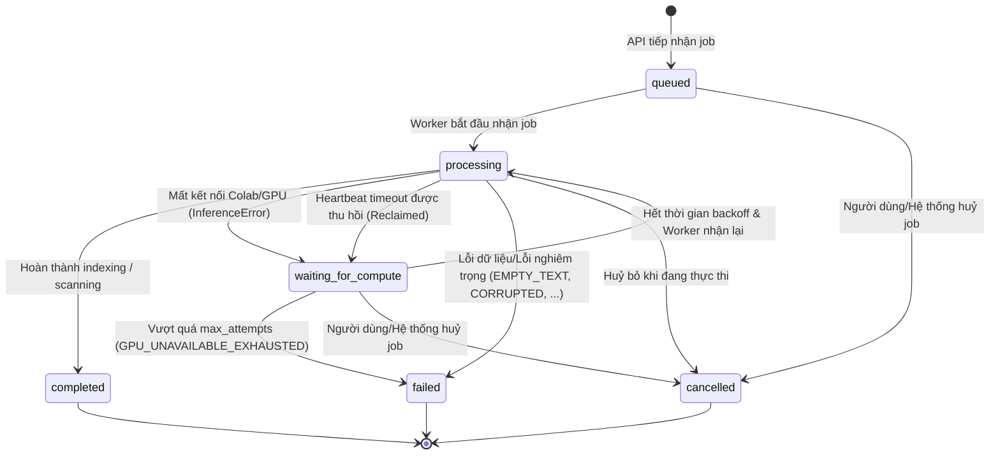

# Đặc tả Vòng đời Job & Độ bền Hệ thống (Job Lifecycle & Resilience Specification)

**Mã tài liệu:** `UGTM-AI-SPEC-CP05.1-LIFECYCLE`  
**Phiên bản:** `1.0.0` (Áp dụng từ Milestone `CP-05.1`)  
**Hệ thống:** UGTM Plagiarism AI Core Pipeline  
**Trạng thái cơ sở dữ liệu:** Neon PostgreSQL (`integrity.jobs` Migration `003_job_lifecycle_resilience.sql`)

---

## 1. Giới thiệu & Mục tiêu

Hệ thống UGTM Plagiarism AI sử dụng mô hình tính toán lai (Hybrid Compute):
- **Phần cứng cục bộ / CPU Backend:** Phân tích tài liệu, chia đoạn (chunking), tìm kiếm từ vựng (BM25 / Trigram), kiểm tra trích dẫn, căn chỉnh câu (passage alignment), và heuristic rules.
- **Phần cứng tăng tốc / GPU Remote (Google Colab / Dedicated Node):** Mã hoá embedding đa ngữ với BGE-M3 (1024 chiều) và tái xếp hạng độ tương đồng ngữ nghĩa sâu với BGE-Reranker-Large.

Do môi trường Colab hoặc remote GPU có thể bị ngắt kết nối đột ngột (timeout, preemptible runtime, reset phiên làm việc, mạng chập chờn), hệ thống cần một **máy trạng thái hoàn chỉnh (Finite State Machine - FSM)** với khả năng chịu lỗi cao:
1. **Không giữ worker ngủ (`time.sleep`)** hoặc mở transaction DB kéo dài trong khi chờ GPU phục hồi.
2. **Khôi phục từng phần dựa trên Checkpoint:** Ghi nhận tiến độ các bước (ví dụ: `parsed`, `retrieved`) để không lặp lại tính toán nặng khi thử lại.
3. **Exponential Backoff & Deadline Policy:** Tự động tăng thời gian chờ sau mỗi lần ngắt kết nối và dừng hẳn khi vượt quá số lần thử tối đa (`max_attempts`).
4. **Giám sát nhịp tim (Heartbeat) & Thu hồi tác vụ treo (Stale Job Reclamation):** Tự động phát hiện và thu hồi các job bị bỏ rơi khi worker đột tử.
5. **Đảm bảo tính lũy thừa (Idempotency) & Chống xung đột Race Condition:** Không tạo báo cáo trùng lặp và không cho phép attempt cũ ghi đè kết quả của attempt mới.

---

## 2. Máy trạng thái Job (State Machine)

Hệ thống định nghĩa chính xác **6 trạng thái chuẩn** cho toàn bộ tác vụ (Index và Scan):



### 2.1. Định nghĩa 6 trạng thái

| Trạng thái (`status`) | Loại | Diễn giải |
| :--- | :--- | :--- |
| `queued` | Transient | Job đã được tạo trong DB, Celery task đã được đẩy vào hàng đợi chờ worker nhận. |
| `processing` | Active | Worker đang chủ động thực thi tác vụ, định kỳ cập nhật `last_heartbeat` và ghi `checkpoint`. |
| `waiting_for_compute` | Paused | Tác vụ tạm dừng do mất kết nối GPU Colab; Celery task được lên lịch lại (`apply_async(..., countdown=T)`). Worker và DB connection được giải phóng hoàn toàn. |
| `completed` | Terminal | Tác vụ hoàn thành thành công, đã lưu báo cáo (`integrity.jobs.report`) hoặc kích hoạt tài liệu nguồn (`is_active = TRUE`). |
| `failed` | Terminal | Tác vụ kết thúc thất bại với mã lỗi định danh (`error_code`), không thể thử lại tự động. |
| `cancelled` | Terminal | Tác vụ bị huỷ bỏ bởi người dùng hoặc hệ thống qua API. |

---

## 3. Ma trận chuyển đổi trạng thái (Transition Matrix)

Hàm `can_transition(from_state, to_state)` trong `app/db.py` thực thi kiểm tra chặt chẽ:

| Từ trạng thái \ Đến trạng thái | `queued` | `processing` | `waiting_for_compute` | `completed` | `failed` | `cancelled` |
| :--- | :---: | :---: | :---: | :---: | :---: | :---: |
| `queued` | - | **HỢP LỆ** | Không | Không | **HỢP LỆ** | **HỢP LỆ** |
| `processing` | Không | **HỢP LỆ** (giữ nguyên) | **HỢP LỆ** (ngắt GPU/treo) | **HỢP LỆ** | **HỢP LỆ** | **HỢP LỆ** |
| `waiting_for_compute` | **HỢP LỆ** (re-queue) | **HỢP LỆ** (resume) | Không | Không | **HỢP LỆ** (hết lượt) | **HỢP LỆ** |
| `completed` | Không | Không | Không | - | Không | Không |
| `failed` | Không | Không | Không | Không | - | Không |
| `cancelled` | Không | Không | Không | Không | Không | - |

> [!IMPORTANT]
> **Nguyên tắc bất biến (Terminal Invariant):**
> Các trạng thái `completed`, `failed`, `cancelled` là **trạng thái kết thúc tuyệt đối (Terminal States)**. Bất kỳ nỗ lực chuyển đổi nào xuất phát từ 3 trạng thái này đều bị từ chối (`can_transition` trả về `False` và DB check constraint / logic code chặn lại).

---

## 4. Thuật toán Exponential Backoff & Chính sách Thử lại

Khi phát hiện mất kết nối GPU (`InferenceError` hoặc `InferenceUnavailableError`), hệ thống áp dụng cơ chế gián cách hàm mũ để không gây quá tải hoặc dồn ứ kết nối:

### 4.1. Công thức tính thời gian chờ

$$T_{\text{wait}} = \min\left(T_{\text{base}} \times 2^{\text{attempt} - 1}, T_{\text{max}}\right)$$

Trong đó:
- $T_{\text{base}} = 10 \text{ giây}$ (thời gian chờ ở lần thử đầu tiên).
- $T_{\text{max}} = 300 \text{ giây}$ (5 phút - giới hạn trần thời gian chờ giữa các lần thử).
- $\text{max\_attempts} = 5$ (số lần thử tối đa mặc định cho mỗi job).

### 4.2. Bảng diễn biến Backoff

| Lần thử (`attempt`) | $2^{\text{attempt}-1}$ | Thời gian chờ ($T_{\text{wait}}$) | Trạng thái kế tiếp |
| :---: | :---: | :---: | :--- |
| **1** | $2^0 = 1$ | $10 \text{ giây}$ | Chuyển sang `waiting_for_compute`, hẹn giờ Celery 10s |
| **2** | $2^1 = 2$ | $20 \text{ giây}$ | Chuyển sang `waiting_for_compute`, hẹn giờ Celery 20s |
| **3** | $2^2 = 4$ | $40 \text{ giây}$ | Chuyển sang `waiting_for_compute`, hẹn giờ Celery 40s |
| **4** | $2^3 = 8$ | $80 \text{ giây}$ | Chuyển sang `waiting_for_compute`, hẹn giờ Celery 80s |
| **5** | $2^4 = 16$ | $160 \text{ giây}$ | Chuyển sang `waiting_for_compute`, hẹn giờ Celery 160s |
| **>= 5** | - | - | **Kiệt số lần thử:** Chuyển thẳng sang `failed` với mã lỗi `GPU_UNAVAILABLE_EXHAUSTED` |

> [!NOTE]
> Khi chuyển sang `waiting_for_compute`, task gọi `scan_document.apply_async(args=[job_id], countdown=T)` và thoát khỏi tiến trình worker ngay lập tức. Worker không bao giờ bị block (`no time.sleep`) và connection pool của PostgreSQL được giải phóng tức thời.

---

## 5. Cơ chế Heartbeat & Thu hồi Job Treo (Stale Job Reclamation)

Khi một worker đang xử lý job nhưng bị crash, restart container hoặc ngắt điện đột ngột:
1. **Heartbeat:** Trong suốt quá trình thực thi, worker cập nhật `last_heartbeat = now()` và `worker_id = worker-{pid}` tại các mốc checkpoint quan trọng.
2. **Ngưỡng Stale:** Nếu một job giữ trạng thái `processing` mà `last_heartbeat` cách thời điểm hiện tại vượt quá $\Delta t_{\text{stale}}$ (mặc định $180\text{s}$):
   - Nếu `attempt < max_attempts`: Tự động tăng `attempt = attempt + 1`, đặt `status = 'waiting_for_compute'`, `error_code = 'WORKER_HEARTBEAT_TIMEOUT'`, `retry_after = now()`. Job sẵn sàng để worker khác tiếp nhận lại.
   - Nếu `attempt >= max_attempts`: Đánh dấu `status = 'failed'`, `error_code = 'WORKER_HEARTBEAT_TIMEOUT_EXHAUSTED'`.
3. **An toàn truy vấn tương tranh:** Quá trình quét thu hồi sử dụng `SELECT ... FOR UPDATE SKIP LOCKED` để nhiều tiến trình cron hoặc admin không tranh chấp cùng một job.

---

## 6. Checkpointing & Điểm khôi phục tiến trình

Trường `checkpoint` kiểu `JSONB` trong bảng `integrity.jobs` lưu lại tiến trình đã hoàn tất:

```json
{
  "phase": "retrieved",
  "candidates_count": 42,
  "timestamp": "2026-10-31T11:15:00Z"
}
```

Các mốc checkpoint:
- `parsed`: Văn bản đã được trích xuất từ PDF/DOCX và phân đoạn chunking xong.
- `retrieved`: Đã thực hiện truy vấn BM25 + dense retrieval thô, danh sách ứng viên đã sẵn sàng cho bước rerank GPU.

---

## 7. Chống Xung đột Tương tranh & Tính lũy thừa (Concurrency & Idempotency)

### 7.1. Cập nhật Hoàn tất có điều kiện (Atomic Conditional Completion)
Để ngăn ngừa tình huống một worker chạy chậm (hoặc tưởng như đã chết) thức dậy và ghi đè kết quả lên một attempt mới hơn hoặc một job đã bị huỷ:
```sql
UPDATE integrity.jobs
SET status = 'completed', report = %s, updated_at = now()
WHERE id = %s::uuid 
  AND status = 'processing' 
  AND attempt = %s;
```
Nếu `rowcount == 0`, worker biết rằng kết quả của nó đã bị thu hồi hoặc job đã bị huỷ; tiến trình sẽ huỷ bỏ kết quả thừa mà không gây xung đột DB.

### 7.2. Idempotent Indexing
- Bảng `integrity.sources` sử dụng `ON CONFLICT (corpus_id, source_key, version) DO UPDATE`.
- Toàn bộ chunks cũ của phiên bản được xoá và chèn lại trong một transaction duy nhất.
- Kích hoạt `is_active = TRUE` chỉ diễn ra sau khi tất cả chunk và vector embedding đã được ghi nhận đầy đủ vào PostgreSQL.

---

## 8. Giao diện Lập trình (REST API)

| Endpoint | Method | Quyền | Mục đích |
| :--- | :---: | :---: | :--- |
| `/api/v1/jobs/{job_id}` | `GET` | API Key | Lấy thông tin trạng thái chi tiết, bao gồm `attempt`, `max_attempts`, `retry_after`, `last_heartbeat`, `checkpoint`. |
| `/api/v1/jobs/{job_id}/cancel` | `POST` | API Key | Huỷ bỏ an toàn một job đang trong trạng thái `queued`, `processing` hoặc `waiting_for_compute`. |
| `/api/v1/jobs/reclaim` | `POST` | API Key | Thu hồi thủ công hoặc theo lịch cron các job `processing` bị treo mất nhịp tim. |

