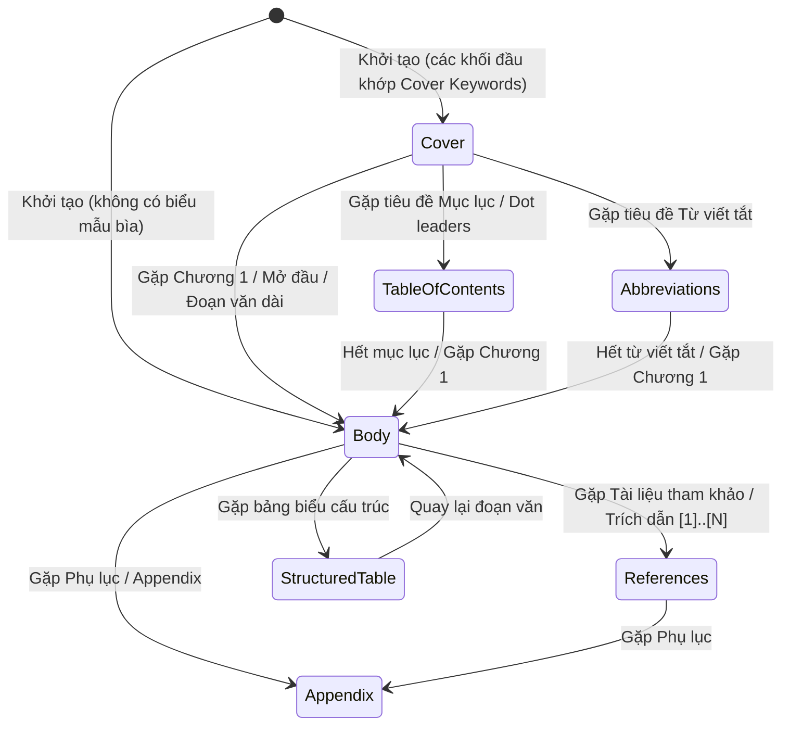

# Đặc Tả Kiến Trúc Parser Mức Block & Ánh Xạ Vị Trí Bằng Chứng (`CP-02.1`)

- **Ngày ban hành:** `2026-10-30`
- **Mã checkpoint:** `CP-02.1`
- **Tệp nguồn chính:** [`app/documents.py`](../app/documents.py)
- **Tệp kiểm thử hồi quy:** [`tests/test_documents_block_parser.py`](../tests/test_documents_block_parser.py)
- **Thư mục fixtures:** `tests/fixtures/`

---

## 1. Bối Cảnh & Vấn Đề Cần Giải Quyết Từ Baseline B0

Trong phiên bản Baseline B0 ([`docs/baseline-audit.md`](./baseline-audit.md)):
1. **Lỗi nuốt toàn bộ thân bài ở DOCX:** Hàm `extract_pages()` gộp toàn bộ các đoạn (`paragraphs`) trong DOCX thành một chuỗi duy nhất và gán vào 1 `TextPage(page_number=None, section_type=...)`. Khi tài liệu bắt đầu bằng trang bìa ("ĐẠI HỌC QUỐC GIA...", "KHÓA LUẬN..."), hàm phân loại gán nhãn `cover` cho toàn bộ tài liệu. Khi lọc `exclude_sections={"cover"}`, **100% thân bài bị xóa sạch** (đã được ghi nhận trong `b0_cover_bug_repro.json`).
2. **Bỏ sót bảng biểu trong DOCX:** Các bảng (`doc.tables`) bị bỏ qua hoàn toàn, không trích xuất được dữ liệu có cấu trúc.
3. **Mất liên kết vị trí đoạn:** DOCX không có khái niệm số trang cố định trong mã XML (số trang phụ thuộc vào font chữ, lề in và phần mềm kết xuất Word). Việc gán số trang giả dẫn tới thông tin sai lệch khi người dùng đối chiếu. Chunks không lưu chỉ số paragraph/block tương ứng.
4. **Nhiễu Header/Footer lặp lại trong PDF:** Tiêu đề đầu trang và chân trang xuất hiện lặp lại ở mọi trang gây nhiễu và làm sai lệch điểm tương đồng.

---

## 2. Thiết Kế Cấu Trúc Dữ Liệu Khối (Block-level Data Structures)

### 2.1. `DocumentBlock`
Đại diện cho một khối cấu trúc nguyên tử trong tài liệu (đoạn văn, bảng biểu, tiêu đề, header, footer):

```python
@dataclass
class DocumentBlock:
    block_index: int                       # Chỉ số khối tuần tự (0, 1, 2, ...)
    block_type: str                        # "paragraph", "table", "heading", "header", "footer", "empty_page"
    page_number: int | None                # 1-based cho PDF; None cho DOCX (TUYỆT ĐỐI không gán trang giả)
    paragraph_index: int | None            # 0-based chỉ số đoạn trong DOCX; None cho bảng hoặc PDF
    raw_text: str                          # Văn bản thô ban đầu
    text: str                              # Văn bản đã chuẩn hóa khoảng trắng
    section_type: str = "body"             # "cover", "table_of_contents", "abbreviations", "body", "references", "appendix", "structured_table", "empty"
    start_char_offset: int = 0             # Vị trí ký tự bắt đầu trong văn bản phân vùng
    end_char_offset: int = 0               # Vị trí ký tự kết thúc trong văn bản phân vùng
    metadata: dict[str, Any] = field(...)  # Bounding box tọa độ (x0, y0, x1, y1) cho PDF
```

### 2.2. `Chunk` Cải Tiến (Ánh Xạ Vị Trí Hai Chiều)
Chunk lưu trữ vị trí xuất phát để UI / Evidence Workbench có thể highlight chính xác đoạn gốc:

```python
@dataclass
class Chunk:
    chunk_no: int                          # Thứ tự chunk
    page_number: int | None                # Trang vật lý (PDF) hoặc None (DOCX)
    start_offset: int                      # Vị trí ký tự bắt đầu
    end_offset: int                        # Vị trí ký tự kết thúc
    text: str                              # Nội dung văn bản chunk
    section_type: str = "body"             # Phân vùng ngữ nghĩa
    start_block_index: int | None = None   # Khối đầu tiên cấu thành chunk
    end_block_index: int | None = None     # Khối cuối cùng cấu thành chunk
    start_paragraph_index: int | None = None # Đoạn DOCX đầu tiên
    end_paragraph_index: int | None = None   # Đoạn DOCX cuối cùng
    page_start: int | None = None          # Trang bắt đầu (PDF)
    page_end: int | None = None            # Trang kết thúc (PDF)
    block_mapping: list[dict[str, Any]]    # Danh sách chi tiết các khối giao nhau
```

---

## 3. Máy Trạng Thái Phân Loại Phân Vùng Văn Bản (Section State Machine)

Xử lý tuần tự theo luồng cấu trúc tài liệu học thuật:



---

## 4. Xử Lý Từng Định Dạng Tệp

### 4.1. Định dạng DOCX
- **Duyệt thứ tự XML gốc:** Lặp qua `doc.element.body` để lấy lần lượt cả đoạn văn (`<w:p>`) và bảng biểu (`<w:tbl>`).
- **Trích xuất bảng biểu:** Đọc từng hàng, loại bỏ trùng lặp ô merge và phân cách các cột bằng ký tự ` | `.
- **Phân nhóm section tự động:** Nhóm các khối liên tiếp có cùng `section_type` thành từng `TextPage` riêng biệt (ví dụ: `cover`, `body`, `references`).
- **Khắc phục lỗi nuốt thân bài:** Khi loại trừ `exclude_sections={"cover"}`, chỉ phần `cover` bị bỏ qua; toàn bộ phần `body` được giữ nguyên vẹn 100%.
- **Chính sách số trang:** Luôn trả về `page_number = None`. Vị trí của DOCX được định danh chính xác qua `paragraph_index` và `block_index`.

### 4.2. Định dạng PDF
- **Giữ thứ tự đọc:** Sử dụng PyMuPDF trích xuất blocks (`page.get_text("blocks")`), sắp xếp khối văn bản theo tọa độ dọc `y0` rồi ngang `x0`.
- **Nhận diện Header/Footer lặp lại:** Quét tự động các dòng ở vùng đỉnh (`y1 <= 75`) và vùng đáy (`y0 >= height - 70`). Nếu một chuỗi văn bản xuất hiện lặp lại trên từ 2 trang trở lên (hoặc khớp regex số trang `Trang X/Y`), khối đó được đánh dấu là `header` hoặc `footer` và loại bỏ khỏi nội dung chính để tránh báo động giả (false alarms).
- **Trang rỗng (Blank Pages):** Trang không chứa khối văn bản nào được gắn nhãn `section_type = "empty"` và không sinh chunk.

---

## 5. Kết Quả Kiểm Thử Hồi Quy (`7/7 PASSED`)

Được xác nhận qua bộ kiểm thử tự động [`tests/test_documents_block_parser.py`](../tests/test_documents_block_parser.py):

| Tên ca kiểm thử | Mục đích kiểm tra | Kết quả |
|---|---|---|
| `test_docx_with_cover_does_not_swallow_body` | DOCX có bìa không làm mất thân bài (giữ đủ 4/4 chunk body) | **PASSED** |
| `test_chunk_bidirectional_block_and_paragraph_mapping` | Chunk map ngược chính xác về `start/end_paragraph_index` và `start/end_block_index` | **PASSED** |
| `test_docx_table_extraction` | Bảng biểu trong DOCX được trích xuất thành khối `table` đầy đủ dữ liệu | **PASSED** |
| `test_pdf_reading_order_and_page_mapping` | PDF giữ đúng số trang vật lý 1-based và thứ tự đọc | **PASSED** |
| `test_pdf_repeating_header_footer_detection` | Phát hiện và khử thành công header/footer lặp qua các trang | **PASSED** |
| `test_pdf_empty_page_handling` | Trang PDF trắng được phân loại `empty` và sinh 0 chunk | **PASSED** |
| `test_cover_body_references_separation_and_filtering` | Tách biệt hoàn toàn `cover`, `body`, `references` trên fixture thực tế | **PASSED** |

