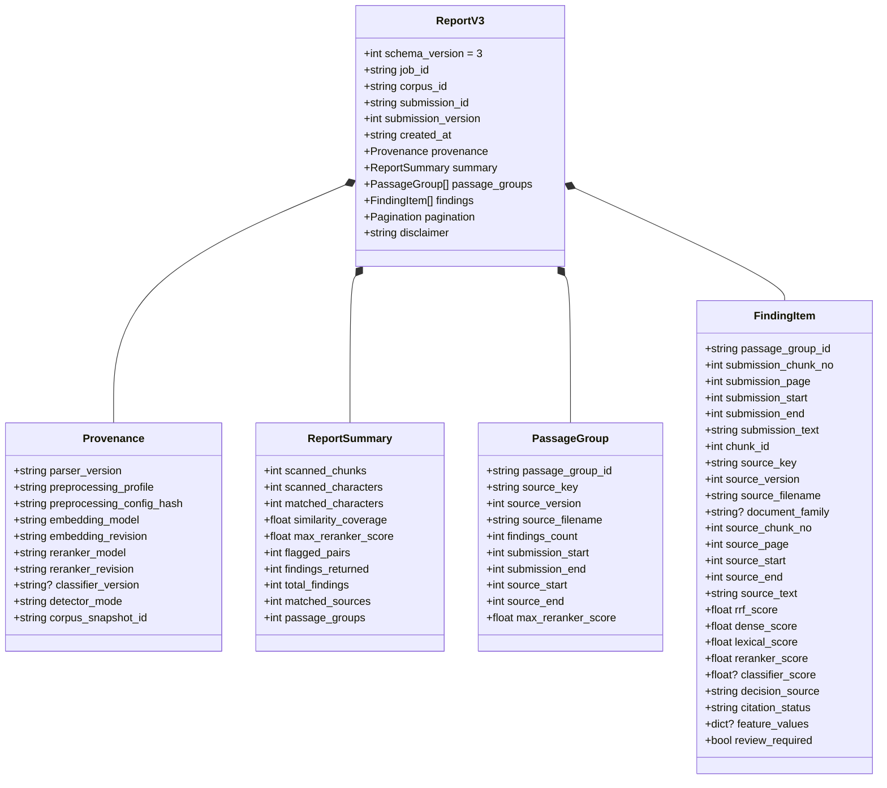

# Đặc Tả Báo Cáo Bằng Chứng Tương Đồng Schema v3 & Provenance (CP-02.4)

> **Mã mốc:** `CP-02.4` & `FREEZE-SCHEMA-V3`  
> **Thời điểm ban hành:** 2026-10-30  
> **Áp dụng cho:** `app/reports.py`, `app/tasks.py`, `app/main.py`, Frontend UI, UGTM Client  
> **Hợp đồng mẫu:** [`docs/contracts/report_v3.sample.json`](../docs/contracts/report_v3.sample.json)

---

## 1. Mục Tiêu Nâng Cấp Từ Schema v2 Lên Schema v3

Phiên bản B0 (Schema v2) tồn tại một số hạn chế về mặt học thuật và kỹ thuật:
1. **Thiếu thông tin nguồn gốc (`Provenance`):** Không lưu trữ `parser_version`, hash cấu hình tiền xử lý, revision mô hình deep learning hoặc mã định danh snapshot corpus.
2. **Cắt cứng kết quả hiển thị (`[:200]`):** Tác vụ quét cắt trực tiếp `all_findings[:200]` trước khi lưu vào DB, làm sai lệch tổng số bằng chứng và đánh mất các đoạn tương đồng ở các trang sau của bài viết dài.
3. **Ngữ nghĩa điểm số mơ hồ:** Dễ bị hiểu nhầm `reranker_score` hoặc `similarity_score` là "tỷ lệ phần trăm đạo văn".
4. **Không tính toán độ phủ thực tế (`Coverage`):** Chưa tính toán tỷ lệ độ dài các khoảng văn bản tương đồng (đã khử chồng lấn do sliding window overlap) trên tổng số ký tự thân bài.

---

## 2. Cấu Trúc Báo Cáo Chuẩn Schema v3

---

## 3. Ngữ Nghĩa Điểm Số & Độ Phủ Tương Đồng (Semantics & Coverage)

### A. Độ Phủ Tương Đồng (`similarity_coverage`)
Được tính toán bằng giải thuật hợp các khoảng ký tự không chồng lấn (Interval Union) trên văn bản thân bài:

$$\text{similarity\_coverage} = \frac{\left| \bigcup_{f \in \text{findings}} \left[ \text{submission\_start}_f, \text{submission\_end}_f \right] \right|}{\text{scanned\_characters}}$$

- **Khử trùng lặp chồng lấn:** Do cơ chế sliding window tạo overlap giữa các chunk kế tiếp nhau, việc cộng dồn đơn thuần độ dài chunk sẽ dẫn đến `coverage > 100%`. Giải thuật hợp khoảng đảm bảo mỗi ký tự trong thân bài chỉ được tính tối đa một lần.
- **Ranh giới:** Luôn nằm trong đoạn $[0.0, 1.0]$.

### B. Điểm Tương Đồng Ngữ Nghĩa (`reranker_score`)
- Là đầu ra xác suất / logit tương đồng từ mô hình Cross-Encoder `BAAI/bge-reranker-v2-m3` cho từng cặp đoạn văn cụ thể.
- **TUYỆT ĐỐI KHÔNG** được gọi điểm số này là "tỷ lệ phần trăm đạo văn". Một đoạn trích dẫn đúng chuẩn mực học thuật vẫn có `reranker_score` cao nhưng là hợp lệ.

### C. Khẳng Định Miễn Trừ Trách Nhiệm (`disclaimer`)
Mọi báo cáo đều bắt buộc đính kèm văn bản:
> *"Similarity evidence only; teachers and evaluators must verify sources, citations and context. No automatic plagiarism verdict."*

---

## 4. Xóa Bỏ Giới Hạn Cứng 200 & Hỗ Trợ Phân Trang

- Trong `app/tasks.py`, toàn bộ `all_findings` được giữ lại và lưu trữ vào cơ sở dữ liệu `integrity.jobs.report`, không bị cắt cụt `[:200]`.
- API endpoint `GET /api/v1/reports/{job_id}` hỗ trợ các tham số truy vấn:
  - `page` (mặc định: `1`, tối thiểu `1`): Số trang cần lấy.
  - `page_size` (mặc định: `100`, tối đa `500`): Số lượng findings trên mỗi trang.
  - Khối `pagination` trả về: `page`, `page_size`, `total_pages`, `total_findings`, `has_next`, `has_prev`.

---

## 5. Bộ Chuyển Đổi Tương Thích Ngược (Compatibility Adapter)

Nhằm đảm bảo các hệ thống client UGTM cũ hoặc các bài test B0 vẫn chạy trơn tru mà không bị crash:
- Truy vấn `GET /api/v1/reports/{job_id}?schema=2` sẽ tự động kích hoạt hàm `convert_report_to_schema_v2()` trong `app/reports.py`.
- Tự động hạ cấp sang định dạng `schema_version: 2`, chuyển `provenance` về khối `model`, giữ nguyên cấu trúc `summary` và `findings` mà client v2 mong đợi.

