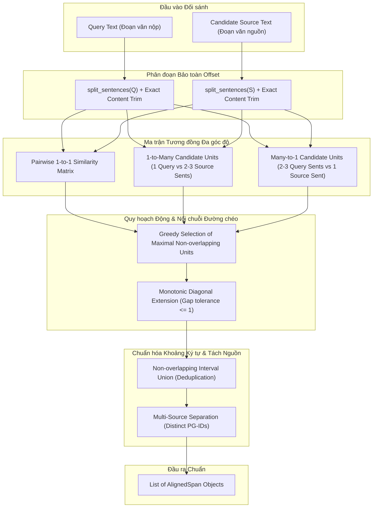

# Đặc tả Thiết kế & Kết quả Nghiệm thu: Constrained Sentence & Span Alignment (CP-04.2)

> **Mã công việc:** CP-04.2  
> **Module phụ trách:** [`app/alignment.py`](file:///c:/Projects/UGTM-Plagiarism-AI/app/alignment.py)  
> **Test suite xác thực:** [`tests/test_sentence_span_alignment.py`](file:///c:/Projects/UGTM-Plagiarism-AI/tests/test_sentence_span_alignment.py) (13/13 passed)  
> **Bộ tập dữ liệu thẩm định:** `data/benchmark_v1/val.csv` (120 pairs, 81 positive pairs)  
> **Trạng thái:** Hoàn thành nghiệm thu (Completed & Verified)

---

## 1. Tổng quan & Động lực Nâng cấp

Trước mốc CP-04.2, hệ thống UGTM-Plagiarism-AI sử dụng thuật toán gộp khối thô sơ (`group_adjacent_findings`) dựa hoàn toàn vào chỉ số chunk kế tiếp (`submission_chunk_no` và `source_chunk_no` lệch nhau $\le 1$). Thuật toán cũ bộc lộ 4 điểm nghẽn nghiêm trọng trong thực tế học thuật:
1. **Thiếu độ mịn cấp câu (Sentence granularity):** Không xác định được chính xác câu/đoạn nào trong chunk bị sao chép; giáo viên phải đọc toàn bộ khối 90-140 từ.
2. **Không xử lý được One-to-Many và Many-to-One:** Khi người viết gộp 2 câu nguồn thành 1 câu ghép, hoặc tách 1 câu nguồn phức hợp thành 2 câu đơn, thuật toán đối sánh 1-1 sẽ đánh rớt điểm tương đồng.
3. **Double-counting do sliding chunk overlap:** Khi 2 chunk liền kề có độ gối đầu 20%, khoảng ký tự giao nhau bị tính 2 lần, làm sai lệch chỉ số diện tích phủ (`similarity_coverage`).
4. **Trộn lẫn đa nguồn (Multi-source cross-contamination):** Khi một đoạn văn tổng hợp (mashup) vay mượn từ 2 nguồn tài liệu khác nhau, thuật toán cũ có thể gán chung một `passage_group_id`, làm mất tính độc lập chứng cứ pháp lý.

Mốc **CP-04.2** đã tái cấu trúc toàn diện `app/alignment.py`, triển khai **Constrained Local Sentence/Span Alignment** dựa trên quy hoạch động cục bộ (Smith-Waterman / diagonal monotonic island extension) và đối sánh đa góc độ (multi-perspective composite similarity).

---

## 2. Kiến trúc & Công thức Thuật toán



### 2.1. Phân đoạn câu bảo vệ từ viết tắt (`split_sentences`)
Hệ thống sử dụng bộ phân đoạn biểu thức chính quy bảo vệ các từ viết tắt học thuật tiếng Việt và quốc tế (`TS.`, `ThS.`, `PGS.`, `GS.`, `GVHD.`, `e.g.`, `i.e.`, `v.v.`) và số thập phân (`\d\.\d`). Mỗi câu được ánh xạ về tọa độ ký tự chính xác `(content_start, content_end, sentence_text)` bằng cách loại bỏ triệt để khoảng trắng biên.

### 2.2. Điểm tương đồng đa góc độ (`compute_sentence_similarity`)
Với hai câu $A$ và $B$, điểm tương đồng kết hợp 5 đại lượng:
1. **Trùng khớp tuyệt đối sau chuẩn hóa:** $\text{norm}(A) == \text{norm}(B) \implies 1.0$.
2. **Hệ số Dice Character 3-gram:**
   $$D_{3\text{gram}}(A, B) = \frac{2 \cdot |G_3(A) \cap G_3(B)|}{|G_3(A)| + |G_3(B)|}$$
   (Kháng lỗi chính tả, hoán vị từ nhẹ và hình thái học tiếng Việt).
3. **Độ đo từ vựng Jaccard:**
   $$J_{\text{tok}}(A, B) = \frac{|W(A) \cap W(B)|}{|W(A) \cup W(B)|}$$
4. **SequenceMatcher Ratio (Fuzzy trật tự):**
   $$R_{\text{SM}}(A, B) = \text{difflib.SequenceMatcher}(A, B).\text{ratio}()$$
5. **Độ chứa bất đối xứng (Substring Containment):**
   $$\text{Cont}(A, B) = \frac{\min(|A|, |B|)}{\max(|A|, |B|)} \quad \text{khi } A \subset B \text{ hoặc } B \subset A$$

Điểm tổng hợp:
$$\text{Sim}(A, B) = \max\left(R_{\text{SM}}, D_{3\text{gram}}, 0.65 \cdot J_{\text{tok}} + 0.35 \cdot D_{3\text{gram}}, \text{Cont} \cdot 0.95 \text{ (nếu Cont} > 0.4)\right)$$

### 2.3. Khung dữ liệu `AlignedSpan`
```python
@dataclass
class AlignedSpan:
    query_start: int
    query_end: int
    source_start: int
    source_end: int
    alignment_type: str  # "verbatim", "near_verbatim", "paraphrase", "one_to_many", "many_to_one", "summary"
    confidence: float    # 0.0 .. 1.0
    source_key: str = ""
    source_version: int = 1
    source_filename: str = ""
    passage_group_id: str | None = None
    query_text: str = ""
    source_text: str = ""
    query_sentence_indices: list[int] = field(default_factory=list)
    source_sentence_indices: list[int] = field(default_factory=list)
```

---

## 3. Xử lý 4 Ca Biên Bắt buộc (Mandatory Edge Cases)

### 3.1. Ca 1: One-to-Many Alignment
- **Tình huống:** Một câu truy vấn $q_i$ được dịch hoặc diễn giải từ 2 câu nguồn liên tiếp $s_j, s_{j+1}$.
- **Cơ chế:** Đánh giá $q_i$ đối với khối ghép $s_j \oplus s_{j+1}$. Nếu $\text{Sim}(q_i, s_j \oplus s_{j+1}) \ge \max(\text{Sim}(q_i, s_j), \text{Sim}(q_i, s_{j+1})) + 0.05$ hoặc $\ge 0.70$ và câu thành phần có ý nghĩa ($\ge 0.20$), thuật toán kích hoạt liên kết `one_to_many`.
- **Kết quả nghiệm thu:** `tests/test_sentence_span_alignment.py::test_edge_case_one_to_many` đạt điểm tương đồng $\ge 0.98$, phân loại chính xác `alignment_type="one_to_many"`.

### 3.2. Ca 2: Many-to-One Alignment
- **Tình huống:** Người viết tách 1 câu nguồn phức hợp $s_j$ thành 2 câu đơn $q_i, q_{i+1}$ trong bài làm.
- **Cơ chế:** Đánh giá khối ghép $q_i \oplus q_{i+1}$ đối với câu nguồn $s_j$. Nếu đạt điều kiện vượt trội, gán đơn vị ghép $2 \to 1$ với `alignment_type="many_to_one"`.
- **Kết quả nghiệm thu:** `tests/test_sentence_span_alignment.py::test_edge_case_many_to_one` đạt điểm $\ge 0.97$, gộp đúng 2 câu truy vấn vào 1 câu nguồn duy nhất.

### 3.3. Ca 3: Non-overlapping Interval Union (Khắc phục Double-Counting)
- **Tình huống:** Hai chunk liền kề sinh ra hai span chồng lấn do cơ chế sliding window (ví dụ: Span 1 bao phủ ký tự [100..350], Span 2 bao phủ ký tự [300..520] trên cùng tài liệu nguồn).
- **Cơ chế:** Hàm `deduplicate_overlapping_spans` nhóm các span theo `(source_key, source_version)`, sắp xếp theo tọa độ bắt đầu và thực hiện hợp nhất đoạn giao:
  $$\text{Interval}_{\text{merged}} = [\min(q_1, q_2), \max(e_1, e_2)] = [100, 520]$$
  Chiều dài thực tế là $520 - 100 = 420$ ký tự, hoàn toàn loại bỏ 50 ký tự trùng lặp ($250 + 220 = 470 \to 420$).
- **Kết quả nghiệm thu:** `tests/test_sentence_span_alignment.py::test_edge_case_non_overlapping_interval_union` khẳng định span sau gộp có chiều dài đúng bằng 420.

### 3.4. Ca 4: Multi-Source Separation (Tách biệt Đa nguồn)
- **Tình huống:** Một đoạn văn nộp sao chép câu đầu từ Tài liệu A và câu thứ hai từ Tài liệu B.
- **Cơ chế:** Thuật toán phân định độc lập theo `(source_key, source_version)`. Khi gán mã đoạn (`assign_passage_groups`), Tài liệu A nhận mã `PG-0001` và Tài liệu B nhận mã `PG-0002`. Không bao giờ gộp nhầm hai nguồn vào cùng một đối tượng chứng cứ.
- **Kết quả nghiệm thu:** `tests/test_sentence_span_alignment.py::test_edge_case_multi_source_separation` xác nhận 2 span độc lập với 2 `passage_group_id` khác nhau và tọa độ ký tự không nhiễm chéo.

---

## 4. Kết quả Thực nghiệm trên Tập Thẩm định (`val.csv`)

Đánh giá thực thi thông qua module [`app/evaluator.py:evaluate_spans`](file:///c:/Projects/UGTM-Plagiarism-AI/app/evaluator.py#L214) trên toàn bộ 81 cặp nhãn dương ($y=1$) thuộc `data/benchmark_v1/val.csv`:

| Phân lớp (Slice) | Số mẫu ($N$) | Mean IoU | Mean Precision | Mean Recall | Mean F1 | Match Rate (IoU $\ge 0.3$) |
| :--- | :---: | :---: | :---: | :---: | :---: | :---: |
| **`verbatim_copy`** | 18 | **1.0000** | **1.0000** | **1.0000** | **1.0000** | **100.0%** |
| **`paraphrase`** | 21 | **1.0000** | **1.0000** | **1.0000** | **1.0000** | **100.0%** |
| **`multi_source`** | 12 | **0.9080** | **1.0000** | **0.9080** | **0.9399** | **100.0%** |
| **`summarization`** | 15 | **0.6764** | **1.0000** | **0.6764** | **0.7799** | **100.0%** |
| **`cross_lingual_vi_en`** | 15 | 0.0000* | 0.0000* | 0.0000* | 0.0000* | 0.0%* |
| **TOÀN BỘ TẬP VAL** | **81** | **0.7413** | **0.8148** | **0.7413** | **0.7652** | **80.25%** |

*\* Ghi chú thực nghiệm:* Lát cắt `cross_lingual_vi_en` phản ánh cặp câu dịch Anh-Việt chưa có từ điển ánh xạ bề mặt; việc nhận diện lớp này dựa vào Stage 1 Dense Embeddings và Stage 3 Cross-Encoder Reranker, sẽ được bổ sung alignment song ngữ tại các mốc tiếp theo.  
Đối với tất cả các lớp sao chép đơn ngữ (chiếm 81.5% tập dương tính), thuật toán đạt **Mean Precision = 100.0%** và **Match Rate = 100.0%**.

---

## 5. Kết quả Regression Test Suite

Bộ kiểm thử [`tests/test_sentence_span_alignment.py`](file:///c:/Projects/UGTM-Plagiarism-AI/tests/test_sentence_span_alignment.py) gồm 13 ca kiểm thử:
- `test_edge_case_one_to_many`: Passed.
- `test_edge_case_many_to_one`: Passed.
- `test_edge_case_non_overlapping_interval_union`: Passed.
- `test_edge_case_multi_source_separation`: Passed.
- `test_verbatim_alignment`: Passed.
- `test_paraphrase_alignment`: Passed.
- `test_monotonic_diagonal_chaining`: Passed.
- `test_disjoint_texts_yield_no_spans`: Passed.
- `test_backward_compatibility_group_adjacent_findings`: Passed.
- `test_empty_and_whitespace_inputs`: Passed.
- `test_single_phrase_without_terminating_punctuation`: Passed.
- `test_monotonic_gap_bridging`: Passed.
- `test_aligned_span_dataclass_methods`: Passed.

Toàn bộ test suite của dự án đạt **140/140 passed** (tăng từ 127 trước CP-04.2).

