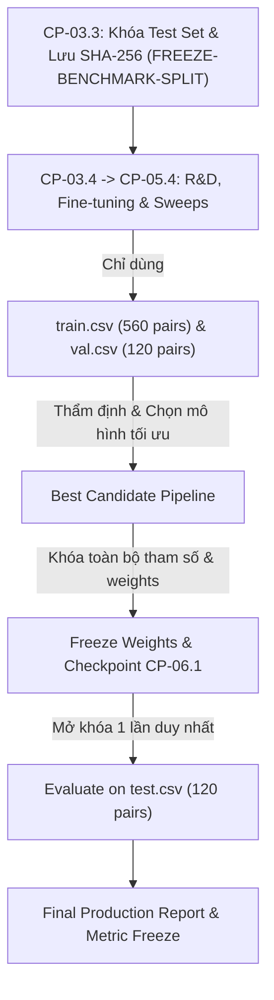

# UGTM Test Split Access Protocol & Freeze Policy (CP-03.3)

**Tài liệu tham chiếu chuẩn:** `docs/test-access-protocol.md`  
**Mã khóa:** `FREEZE-BENCHMARK-SPLIT`  
**Phiên bản benchmark:** `UGTM-Bench-v1` (1.0.0)  
**Tập tin khóa:** `data/benchmark_v1/test.csv` (120 pairs, SHA-256 đối soát tại `split_manifest.json`)  
**Ngày niêm phong:** 30/10/2026  
**Thời điểm mở khóa hợp lệ:** Checkpoint `CP-06.1 — Blind Test & Báo cáo kết quả tổng kết`.

---

## 1. Mục tiêu và Nguyên tắc Khoa học

Tập kiểm thử `test.csv` là thước đo khách quan duy nhất để đánh giá hiệu năng thực tế của hệ thống UGTM Plagiarism AI trước khi triển khai sản phẩm. Theo chuẩn khoa học quốc tế về Machine Learning và NLP (NeurIPS, ACL, ICSE), mọi hành vi truy cập hoặc tinh chỉnh trên tập test trong quá trình nghiên cứu/phát triển đều dẫn đến hiện tượng **Data Snooping Bias** và làm mất tính hợp lệ của toàn bộ nghiên cứu.

Nguyên tắc cốt lõi:
1. **Zero Test Snooping (Không nhìn trộm tập test):** Tập test được bảo vệ bằng cơ chế niêm phong logic và kiểm toán SHA-256. Không được chạy suy luận, kiểm thử thử nghiệm, hoặc phân tích định tính trên tập test trong suốt các checkpoint từ `CP-03.4` đến `CP-05.4`.
2. **Strict Split Boundary (Phân ranh giới tuyệt đối):** Toàn bộ việc lựa chọn mô hình (model selection), dò tìm ngưỡng tương đồng ($k$, threshold $\tau$), tinh chỉnh quy tắc lọc regex, và huấn luyện/finetune chỉ được phép thực hiện trên tập `train.csv` và kiểm chứng trên tập phát triển `val.csv` (Development / Validation set).
3. **Mở khóa duy nhất 1 lần (Single-pass Unseal):** Tập test chỉ được nạp vào evaluator đúng một lần duy nhất tại `CP-06.1` để ghi nhận kết quả cuối cùng (Final Blind Benchmark Report).

---

## 2. Các Hành Vi Bị Nghiêm Cấm Tuyệt Đối (Forbidden Activities)

Dưới đây là các hành vi bị cấm tuyệt đối đối với `data/benchmark_v1/test.csv`:

| STT | Hành vi bị cấm | Lý do cấm |
| :--- | :--- | :--- |
| **1** | Sử dụng `test.csv` để sweep/tune siêu tham số (Hyperparameter Sweep: $K$ nearest neighbors, threshold $\tau$, rerank weights). | Gây overfitting cục bộ lên tập test; điểm số cao là giả tạo và không khái quát được cho tài liệu ngoài đời thực. |
| **2** | Chọn lựa mô hình (Model Selection) dựa trên điểm số của `test.csv` (ví dụ so sánh BM25 vs BGE-M3 vs MiniLM trên test). | Mọi so sánh mô hình trong quá trình R&D phải thực hiện trên `val.csv`. |
| **3** | Đọc nội dung query/source của `test.csv` để viết thêm regex, quy tắc trích lọc hoặc prompt engineering thủ công. | Ô nhiễm tri thức ngoại lai (Information Leakage via Human Prompt Engineering). |
| **4** | Đưa `test.csv` vào dữ liệu huấn luyện (Pre-training, Fine-tuning, LoRA, Prompt tuning). | Trực tiếp vi phạm đạo đức nghiên cứu và tính toàn vẹn của mô hình. |
| **5** | Chạy lặp lại nhiều lần trên tập test và chỉ chọn lần chạy có kết quả cao nhất để báo cáo (Cherry-picking). | Thiếu tính trung thực khoa học. |

---

## 3. Quy Trình Sử Dụng Hợp Lệ Theo Từng Checkpoint

- **Giai đoạn R&D (`CP-03.4` đến `CP-05.4`):**
  - Mọi hàm benchmark trong `app/evaluator.py`, `scripts/evaluate_benchmark.py` phải mặc định tham số `--split val`.
  - Nếu người dùng hoặc agent vô tình chỉ định `--split test`, evaluator phải kiểm tra cờ khóa `--unseal-test-for-final-report` và từ chối thực thi trừ khi đang ở checkpoint `CP-06.1`.
- **Giai đoạn Thẩm định Cuối (`CP-06.1`):**
  - Người thực thi kích hoạt cờ xác nhận mở khóa chính thức.
  - Bộ evaluator nạp `test.csv`, đối soát SHA-256 với `split_manifest.json`. Nếu hash sai khác dù chỉ 1 bit, lập tức hủy bỏ quá trình và báo động file bị sửa đổi.
  - Xuất báo cáo điểm số Blind Test, phân rã theo 7 lát cắt (slices), tính Confidence Interval 95% bằng Bootstrap.

---

## 4. Bảng Tra Cứu và Phân Quyền Tập Tin

| Tên tập tin | Số lượng mẫu | Tỷ lệ | Quyền truy cập trong R&D (`CP-03.4` - `CP-05.4`) | Mục đích sử dụng |
| :--- | :--- | :--- | :--- | :--- |
| `data/benchmark_v1/train.csv` | 560 pairs | 70% | **Read / Write (Phân tích, Huấn luyện)** | Huấn luyện mô hình, tinh chỉnh biểu diễn, phân tích phân phối đặc trưng. |
| `data/benchmark_v1/val.csv` | 120 pairs | 15% | **Read-Only (Đánh giá)** | Tinh chỉnh tham số, sweep threshold, so sánh giữa các ứng viên mô hình (Validation). |
| `data/benchmark_v1/test.csv` | 120 pairs | 15% | **LOCKED (Khóa niêm phong)** | Chỉ đọc một lần duy nhất tại `CP-06.1` cho báo cáo nghiệm thu sản phẩm. |
| `data/benchmark_v1/split_manifest.json` | 1 file | - | **Read-Only (Khóa SHA-256)** | Lưu mã băm toàn vẹn và bằng chứng toán học về zero-leakage. |

---

## 5. Cam Kết Tính Toàn Vẹn Của Nhà Phát Triển (Solo Developer Pledge)

Dự án UGTM Plagiarism AI được phát triển bởi một kỹ sư độc lập. Vì không có hội đồng độc lập giám sát bên ngoài trong quá trình gán nhãn, nhà phát triển cam kết tuân thủ tuyệt đối:
1. Không sửa đổi file `test.csv` sau khi đã niêm phong tại `CP-03.3`.
2. Ghi nhận trung thực điểm số đầu tiên trên tập test tại `CP-06.1`, không che giấu lỗi hay các trường hợp dự đoán sai của mô hình.

